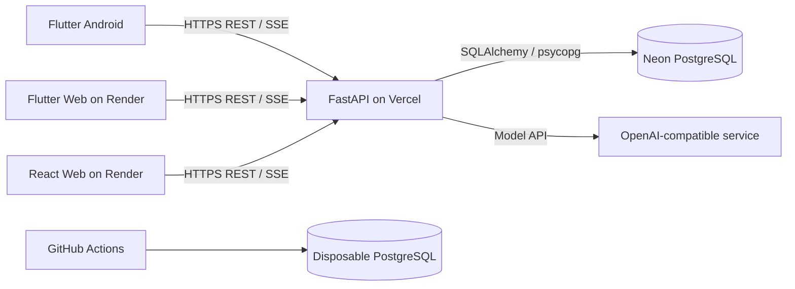

# SayFridge

SayFridge is a household inventory system that helps people record what they
have, where it is stored, how much remains, and what will expire soon. The
system combines an Android-focused Flutter application, a React web
application, and a shared FastAPI backend backed by PostgreSQL. An AI assistant
can translate text and supported image input into controlled inventory actions;
the backend remains responsible for authentication, ownership checks, quantity
rules, and database transactions.

This repository is the implementation project for COMPSCI 734, developed by
Team Appix.

## Target users and user need

SayFridge is intended for people who manage food and household supplies across
several storage spaces, such as a fridge, freezer, pantry, or cupboard. It aims
to reduce forgotten stock and duplicate purchases by making these common tasks
easier:

- recording purchases and existing stock;
- checking the current quantity and storage location of an item;
- recording additions, consumption, and physical stocktakes;
- moving, discarding, or archiving inventory;
- finding overdue and soon-to-expire items; and
- managing accounts and account status as an administrator.

## Why there are separate Mobile and Web applications

The two clients share the same accounts, inventory, and FastAPI API, but support
different contexts rather than duplicating the same interface.

| Client | Primary use |
| --- | --- |
| Flutter Mobile | Quick use while shopping or standing near stored items; camera, image selection, voice input, and guided inventory actions. |
| React Web | Large-screen inventory review, search and filtering, batch stock entry and movement, expiry reporting, operation history, and administrator account management. |

The Flutter project also has a Web build so assessors can open the Mobile UI in
a browser. This is a deployment and demonstration entry point; Android device
or emulator testing is still required for native permissions and device
features.

## Core features

- Email/password registration and sign-in with short-lived bearer tokens.
- User-owned storage spaces and private item definitions with shared categories.
- Inventory listing, detail, search, pagination, metadata editing, and movement.
- Atomic batch creation, movement, and archival.
- ADD, CONSUME, and RECONCILE quantity operations with idempotent retries.
- Inventory discard/archive actions and per-item/global operation history.
- Expiry summary and overdue/upcoming inventory views.
- Administrator account listing and permitted status management.
- Text AI assistant with streamed responses, clarification, confirmation,
  recovery, and controlled inventory tools.
- Flutter inventory, storage-space, profile, and text-assistant workflows for
  Android and Web.

The maintained API contracts and exact endpoint behaviour are documented in
[the API reference](docs/API_REFERENCE.md). Current product scope is documented
in [the project scope](docs/PROJECT_SCOPE_BILINGUAL.md).

## Technology stack and architecture

| Layer | Technology | Responsibility |
| --- | --- | --- |
| Mobile | Flutter / Dart | Android-focused user experience, camera/image/voice input, and mobile inventory workflows. |
| Web | React, TypeScript, Vite, React Router, TanStack Query | Desktop user and administrator workflows. |
| Backend | FastAPI, Pydantic, SQLAlchemy 2.x, Alembic | Versioned REST/SSE API, authentication, validation, business rules, and transactions. |
| Agent | LangGraph and an OpenAI-compatible model API | Interprets user requests and proposes or executes allowlisted inventory actions. |
| Database | PostgreSQL hosted on Neon | Persistent users, storage spaces, catalogue, inventory, operation, and Agent state. |
| Hosting | Render and Vercel | Static Web/Flutter Web hosting and the deployed FastAPI service. |
| CI | GitHub Actions with disposable PostgreSQL | Automated Backend core regression without using shared Neon data. |



The browser clients never connect directly to PostgreSQL or the model service.
FastAPI derives the user identity from the bearer token and applies ownership
and role checks before database access. Runtime database traffic uses the Neon
pooled connection; Alembic and setup operations use a direct connection.

More detailed design documentation is available in:

- [Architecture](docs/ARCHITECTURE.md)
- [Backend design](docs/BACKEND_DESIGN.md)
- [Database design](docs/DATABASE_DESIGN.md)
- [Quantity-state design](docs/QUANTITY_STATE_DESIGN.md)
- [Testing evidence](docs/testing/README.md)

## Assessment entry points

| Component | URL |
| --- | --- |
| React Web | <https://project-implementation-appix.onrender.com> |
| Flutter Mobile Web | <https://sayfridge-mobile.onrender.com> |
| Flutter Mobile Web integration site | <https://sayfridge-mobile-test.onrender.com> |
| Backend health | <https://sayfridge-backend-preview.vercel.app/health> |
| Swagger UI | <https://sayfridge-backend-preview.vercel.app/docs> |
| Backend base URL | <https://sayfridge-backend-preview.vercel.app> |

Assessment credentials are not stored in this public repository. They must be
provided through the course-approved private-data channel.

## Repository layout

```text
backend/   FastAPI application, migrations, setup scripts, and pytest suite
web/       React/TypeScript web application and Vitest suite
mobile/    Flutter Android/Web application and Flutter tests
docs/      Architecture, API, database, design, and test documentation
.github/   GitHub Actions workflows
```

## Local development prerequisites

- Git
- Python 3.12
- Node.js 22 or newer and npm
- Flutter 3.44.8 with Dart 3.12.2
- Android Studio / Android SDK for Android development
- PostgreSQL, or a Neon PostgreSQL project with pooled and direct connection
  strings

Real credentials belong only in ignored local environment files or deployment
secret managers. Never commit `.env`, `.env.test`, database passwords, JWT
secrets, or model API keys.

## Run the Backend

From the repository root:

```bash
cd backend
python3.12 -m venv .venv
source .venv/bin/activate
python -m pip install -r requirements.txt
cp .env.example .env
```

Edit `backend/.env` and set at least:

- `DATABASE_URL`: pooled PostgreSQL URL used by FastAPI;
- `DATABASE_URL_DIRECT`: direct PostgreSQL URL used by Alembic;
- `JWT_SECRET_KEY`: a random secret of at least 32 characters;
- `CORS_ORIGINS`: an exact JSON list of allowed browser origins; and
- `AGENT_API_KEY` plus the other `AGENT_*` settings when using the Agent.

Both database URLs use the `postgresql+psycopg://` prefix. Initialise and verify
all business tables, the public category catalog, and Agent persistence from
`backend/`:

```bash
python scripts/initialize_database.py
```

The command is safe to repeat and must finish before the API is started against a
fresh database. It does not run implicitly during FastAPI startup. Read
[Agent configuration and storage](backend/README.md#agent-configuration-and-storage)
for the separate inspection and repair commands used with existing databases.

Start the API:

```bash
python -m uvicorn app.main:app --reload --host 127.0.0.1 --port 8000
```

Local health and API documentation are then available at:

- <http://127.0.0.1:8000/health>
- <http://127.0.0.1:8000/docs>

Windows setup and additional database details are in the
[Backend README](backend/README.md).

## Run the React Web application

Start the Backend first, then open a second terminal:

```bash
cd web
npm install
npm run dev
```

Open <http://localhost:5173>. During local development, Vite proxies `/api`
requests to `http://127.0.0.1:8000`. For a deployed build, set
`VITE_API_BASE_URL` to the HTTPS Backend URL including `/api/v1` before running
the build. `VITE_*` values are compiled into browser JavaScript and must never
contain secrets.

See the [Web README](web/README.md) for routes and deployment behaviour.

## Run the Flutter application

Install Flutter and an Android emulator or connect an Android device:

```bash
cd mobile
flutter pub get
flutter run -t lib/main.dart \
  --dart-define=API_BASE_URL=http://10.0.2.2:8000/api/v1
```

`10.0.2.2` is the Android emulator address for the host machine. A physical
device must use an API address reachable from that device. To run the Flutter
Web build locally against the Backend:

```bash
flutter run -d chrome --web-port=5174 -t lib/main.dart \
  --dart-define=API_BASE_URL=http://127.0.0.1:8000/api/v1
```

Add `http://localhost:5174` to the Backend `CORS_ORIGINS` while using this local
browser configuration. See the [Mobile README](mobile/README.md) for Android,
Web, preview, and deployment details.

## Run the tests

See the [testing guide and CI policy](docs/testing/README.md) for automated
checks, test scope, and result artifacts. Every PR runs Backend core checks
(for PRs targeting `main`) and the Web/Flutter fast checks.

GitHub Actions is the automated entry point: [Backend CI](.github/workflows/backend-ci.yml)
and [Frontend CI](.github/workflows/frontend-ci.yml). For local verification, use
the per-module commands below and the testing guide. Backend **Run workflow**
executes full regression; its automatic PR/main runs execute the fast selection.

### Backend

Backend database tests require a direct connection to an isolated PostgreSQL
database whose name ends in `_test`. Copy the template and replace its
placeholders locally:

```bash
cd backend
cp .env.test.example .env.test
python -m pytest -v
```

Useful selections:

```bash
python -m pytest -v -m ci --strict-markers  # fast CI regression
python -m pytest -v -m postgres             # PostgreSQL-backed tests
```

The test fixtures migrate a random schema per database test and remove it after
the test. GitHub Actions supplies a disposable PostgreSQL service and does not
use Neon credentials. Live model tests are opt-in because they consume an API:

```bash
AGENT_LIVE_MODEL=1 python -m pytest -q tests/test_agent_live_model.py
```

### React Web

```bash
cd web
npm install
npm run lint
npm test
npm run build
```

Vitest and Testing Library use MSW-controlled API responses and do not contact a
deployed Backend.

### Flutter

```bash
cd mobile
flutter pub get
flutter analyze
flutter test --exclude-tags manual_preview
flutter build web --release --no-web-resources-cdn \
  --dart-define=API_BASE_URL=https://sayfridge-backend-preview.vercel.app/api/v1
```

### End-to-end acceptance

The [Core E2E guide](docs/testing/README.md#core-e2e-foundation) describes the
isolated Playwright/Web/Backend/PostgreSQL environment and its manual GitHub
workflow. After the one-time setup, run from the repository root:

```bash
python backend/scripts/run_e2e.py
```

The first automated scenario covers registration, sign-out, login and an empty
inventory. Continue to validate the broader deployed-system path manually and
record the tested commit and result:

1. Register and sign in.
2. Create a storage space.
3. Add an inventory item.
4. Record consumption and a physical reconciliation.
5. Confirm that the React Web application shows the updated inventory and
   operation history.
6. Open the expiry view and verify overdue/upcoming grouping.
7. Confirm that an ordinary user receives `403` for administrator APIs, then
   repeat the account-management check with an administrator account.

## Team

- syan349 (`syan349`)
- weizhou537 (`wzho537`)
- UQwinder (`qche584`)
- DaryaRastegar (`dras728`)
- hrainy (`rhan637`)

## Privacy and security

- [Security and Privacy](docs/SECURITY_AND_PRIVACY.md): controls, data handling, findings and fixes, test/audit evidence, and remaining risks.
