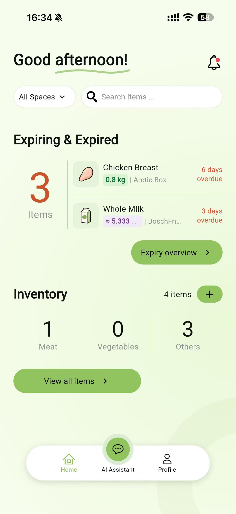
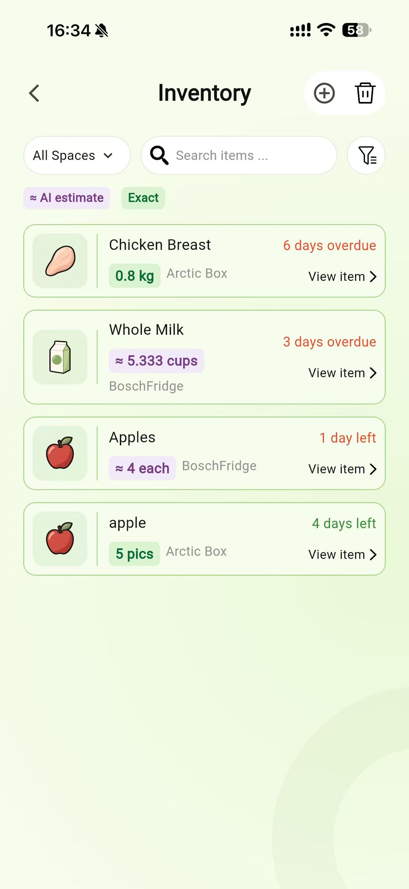
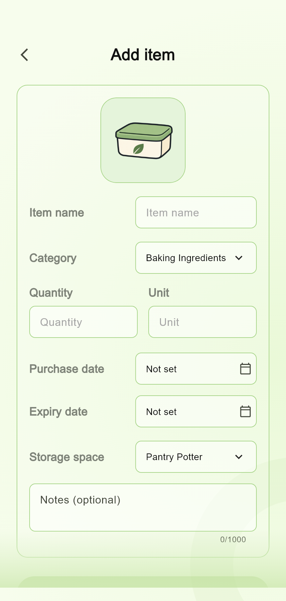
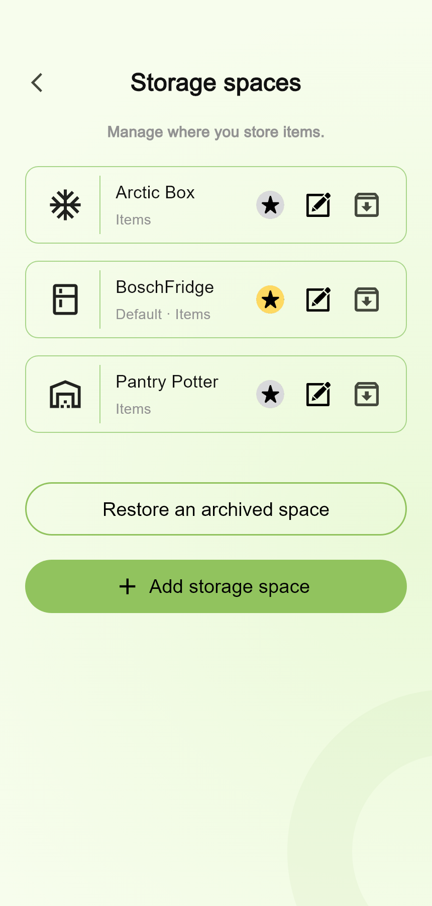
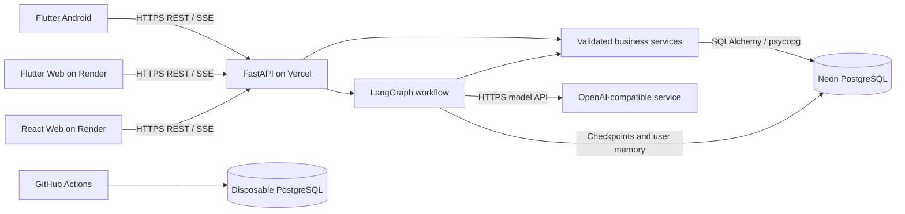

# SayFridge


SayFridge is a household inventory system that helps people record what they
have, where it is stored, how much remains, and what will expire soon. The
system combines an Android-focused Flutter application, a React web
application, and a shared FastAPI backend backed by PostgreSQL. An AI assistant
can translate text, editable speech transcripts, and supported image input into inventory actions;
the backend remains responsible for authentication, ownership checks, quantity
rules, and database transactions.

This repository is the implementation project for COMPSCI 734, developed by
Team Appix.

<br clear="right" />

[Try the system](#assessment-entry-points) · [Run locally](#local-development-prerequisites) ·
[Run tests](#run-the-tests) · [Architecture](#technology-stack-and-architecture) ·
[Assessment evidence](#documentation-and-assessment-evidence) · [Team Wiki](https://github.com/UOA-CS734-S2-2026/project-implementation-appix/wiki)

## App screenshots

Home, Inventory, AI inventory query, and Expiry overview show team-supplied
demonstration screenshots from 4 October 2026. Add item and Storage spaces are
Flutter widget renders of the updated UI. Select an image to view it at full size.

| Home dashboard | Inventory | AI inventory query |
| :---: | :---: | :---: |
| <a href="docs/images/readme/mobile-home.jpg"></a> | <a href="docs/images/readme/mobile-inventory.jpg"></a> | <a href="docs/images/readme/mobile-ai-inventory-query.jpg"></a> |
| Review stock and expiry alerts. | View exact and estimated balances. | Ask what is in your fridge. |

| Add item | Storage spaces | Expiry overview |
| :---: | :---: | :---: |
| <a href="docs/images/readme/mobile-add-item.png"></a> | <a href="docs/images/readme/mobile-storage-spaces.png"></a> | <a href="docs/images/readme/mobile-expiry-overview.jpg"></a> |
| Add stock with quantity and dates. | Organize stock by storage location. | Find overdue and upcoming items. |

## Target users and user need

SayFridge is intended for people who manage food and household supplies across
several storage spaces, such as a fridge, freezer, pantry, or cupboard. It aims
to reduce forgotten stock and duplicate purchases by making these common tasks
easier:

- recording purchases and existing stock;
- checking the current quantity and storage location of an item;
- recording additions, consumption, and physical stocktakes;
- moving, discarding, or archiving inventory;
- finding overdue and soon-to-expire items; and
- managing accounts and account status as an administrator.

## Why there are separate Mobile and Web applications

The two clients share the same accounts, inventory, and FastAPI API, but support
different contexts rather than duplicating the same interface.

| Client | Primary use |
| --- | --- |
| Flutter Mobile | Quick use while shopping or standing near stored items; camera, image selection, voice input, and guided inventory actions. |
| React Web | Large-screen inventory review, search and filtering, batch stock entry and movement, expiry reporting, operation history, and administrator account management. |

The Flutter project also has a Web build so assessors can open the Mobile UI in
a browser. This is a deployment and demonstration entry point; Android device
or emulator testing is still required for native permissions and device
features.

## Core features

- Email/password registration and sign-in with automatic renewal and revocable device sessions.
- Storage spaces with a default location, archive/restore, private item definitions,
  and public or user-owned categories.
- Inventory listing, detail, search, pagination, metadata editing, and movement.
- Atomic batch creation, movement, and archival.
- ADD, CONSUME, and RECONCILE quantity operations with idempotent retries.
- Inventory discard/archive actions and per-item/global operation history.
- Expiry summary and overdue/upcoming inventory views.
- Administrator account listing and permitted status management.
- AI assistant for text and photos, with streamed responses, clarification,
  review cards, explicit user memory, and recovery of unfinished requests.
- Approximate quantities remain visibly estimated until the user records an
  exact physical stocktake. Missing expiry dates can be estimated, with warnings
  when estimation fails.
- Flutter Home, inventory, storage-space, Profile, local reminder, and Daily
  Check-in workflows for Android and Web.

Complete, unambiguous text actions can execute directly. Photo-derived stock,
category-review cases, and user-requested approval require confirmation; missing
facts or ambiguous items require clarification. The AI calls the backend's
allowlisted business services, which validate and authorize inventory changes.

The maintained API contracts and exact endpoint behaviour are documented in
[the API reference](docs/reference/API_REFERENCE.md). Current product scope is documented
in [the project scope](docs/product/README.md).

## Mobile capabilities and user value

| Capability | How it supports the user | Implementation and verification |
| --- | --- | --- |
| Camera and photo library | Capture food or purchase images, preview/remove photos, and review proposed stock before saving. This reduces typing while retaining control over quantities and storage. | Camera/image-picker input and shared review UI; [Mobile guide](mobile/README.md#interaction-and-state), [multimodal test report](docs/testing/reports/AGENT_MULTIMODAL_TEST_RESULTS.md). |
| Speech and touch gestures | Hold to speak while shopping or cooking, release to edit the transcript, slide up to cancel, and send explicitly. Speech recognition supplies editable text to the assistant. | Shared `AgentInputPanel`; [Mobile interaction guide](mobile/README.md#interaction-and-state). |
| Local notifications | Surface expired/upcoming stock and check-in reminders, with per-user settings and permission handling. | [Profile and reminders](mobile/README.md#profile-and-reminders); [manual integration record](docs/testing/reports/MANUAL_INTEGRATION_TEST_RECORD.md). |

Android permission, camera, microphone, and notification behavior must be checked
on a device or emulator; widget tests and the Flutter browser build do not establish
native acceptance. The selected APK/device results belong in the
[Final Acceptance Record](docs/testing/reports/FINAL_ACCEPTANCE.md#manual-cross-client-and-android-validation).

## Technology stack and architecture

| Layer | Technology | Responsibility |
| --- | --- | --- |
| Mobile | Flutter / Dart | Android-focused user experience, camera/image/voice input, and mobile inventory workflows. |
| Web | React, TypeScript, Vite, React Router, TanStack Query | Desktop user and administrator workflows. |
| Backend | FastAPI, Pydantic, SQLAlchemy 2.x, Alembic | Versioned REST/SSE API, authentication, validation, business rules, and transactions. |
| Agent | LangGraph and an OpenAI-compatible model API | Interprets user requests and proposes or executes allowlisted inventory actions. |
| Database | PostgreSQL hosted on Neon | Persistent users, storage spaces, catalogue, inventory, operation, and Agent state. |
| Hosting | Render and Vercel | Render serves React/Flutter Web; Vercel runs FastAPI. Android calls the same API directly. |
| CI | GitHub Actions with disposable PostgreSQL | Backend/Web/Flutter fast checks, conditional browser E2E and manual full regression. |



The browser clients never connect directly to PostgreSQL or the model service.
FastAPI derives the user identity from the bearer token and applies ownership
and role checks before database access. Runtime database traffic uses the Neon
pooled connection; Alembic and setup operations use a direct connection.

### Architecture decisions and tradeoffs

| Choice | Reason and tradeoff |
| --- | --- |
| One modular FastAPI backend | Both clients share validation, authorization, and quantity rules. Routers, schemas, services, and persistence have separate responsibilities without the operational cost of microservices. |
| REST/JSON for inventory resources | HTTP methods, status codes, and generated OpenAPI contracts make integration explicit for both clients. The current resource workflows do not require GraphQL's flexible query layer. |
| Authenticated POST with SSE for assistant replies | Sends prompts/images and streams text, proposals, and results incrementally. Confirmation resumes through a later request; continuous two-way WebSocket sessions are unnecessary for this interaction. |
| PostgreSQL transactions, version checks, and idempotency | Prevent partial manual batches, lost updates, and duplicate quantity changes when requests are retried. Database-backed receipts and sessions work across backend instances. |
| LangGraph checkpoints plus business receipts | Checkpoints restore questions and drafts; receipts establish whether a write committed. Recovery checks both so interrupted replies do not duplicate inventory changes. |
| Pooled runtime connections and direct session connections | Pooling bounds ordinary query connections. Migrations, Agent persistence, and session-level advisory locks use direct connections where session identity matters. |

The [architecture guide](docs/architecture/README.md) records alternatives and
capacity assumptions. The initial workload is 100 users and 5 requests/second
with 50,000 inventory batches and 500,000 operations. The dated
[performance record](docs/testing/records/PERFORMANCE_TEST_RECORD.md) reports
3,000 successful requests in the local 10-minute baseline and 120 successful
hosted reads on 4 October 2026; it also retains a provider rate-limit failure
in one of ten real-model samples. These results describe the tested environments
and revisions. Further scaling requires measuring query, connection, and lock
pressure before changing pool sizes, indexes, or instance counts.

Additional learning in persistent AI workflows, multimodal validation, rotating
sessions, cloud database connections, and realistic browser testing is explained
in [Learning and Design Evolution](docs/learning/README.md), with code and test
evidence for each technique's contribution to the product.

## Documentation and assessment evidence

This README is the project entry point. Each subject guide owns its detailed
content; module READMEs retain local setup and checks.

| Canvas criterion | What to inspect | Evidence entry |
| --- | --- | --- |
| 1. Integrated system (8%) | Distinct Mobile/Web workflows using the same accounts, API, and persisted inventory | [Product scope](docs/product/README.md), [API reference](docs/reference/API_REFERENCE.md), [browser E2E](docs/testing/README.md#core-e2e) |
| 2. Flutter and chosen tools (10%) | Widgets, state/controllers, repositories, navigation, asynchronous API handling, and cloud integration | [Mobile guide](mobile/README.md), [Mobile source](mobile/lib), [architecture](docs/architecture/README.md) |
| 3. Independent learning (6%) | Persistent AI workflows, multimodal input, refresh sessions, PostgreSQL connection behavior, and CI composition | [Learning and Design Evolution](docs/learning/README.md) |
| 4. Genuine user need (8%) | Target users, user stories, and delivered stock/expiry workflows | [User stories and verification](docs/product/README.md#core-user-stories-and-evidence) |
| 5. Mobile capabilities (10%) | Camera/gallery, editable speech, gestures, and local notifications | [Mobile capabilities](#mobile-capabilities-and-user-value), [manual integration record](docs/testing/reports/MANUAL_INTEGRATION_TEST_RECORD.md), [native acceptance record](docs/testing/reports/FINAL_ACCEPTANCE.md#manual-cross-client-and-android-validation) |
| 6. Architecture and justification (10%) | Diagram, REST/SSE choices, transaction boundaries, recovery, and capacity planning | [System Architecture](docs/architecture/README.md), [quantity rules](docs/architecture/QUANTITY_STATE_DESIGN.md), [performance record](docs/testing/records/PERFORMANCE_TEST_RECORD.md) |
| 7. Engineering practice (8%) | Module boundaries, locked dependencies, validation, migrations, local lint/analyze commands, and CI | [Repository layout](#repository-layout), [Backend](backend/README.md), [Web](web/README.md), [Mobile](mobile/README.md), [.gitignore](.gitignore) |
| 8. Testing strategy (10%) | Unit, API/database, component/widget, browser, manual/native, model, and performance verification | [Testing strategy and reports](docs/testing/README.md), [CI workflows](.github/workflows) |
| 9. Security and privacy (4%) | Ownership/role checks, sessions, hostile inputs, image metadata, secret handling, and OWASP-related findings | [Security and Privacy](docs/security/README.md) |
| 10. Project management and teamwork (12%) | Dated meeting records, assigned work, project tracking, feature branches, commits, and reviewed PRs | [Meetings](https://github.com/UOA-CS734-S2-2026/project-implementation-appix/wiki/Meeting-Records), [responsibilities](https://github.com/UOA-CS734-S2-2026/project-implementation-appix/wiki/Team-Responsibilities), [Issues](https://github.com/UOA-CS734-S2-2026/project-implementation-appix/issues), [boards](https://github.com/UOA-CS734-S2-2026/project-implementation-appix/projects), [PRs](https://github.com/UOA-CS734-S2-2026/project-implementation-appix/pulls) |
| 11. Deployment (8%) | Hosted client/API entry points, database migration, Android build/install, and version matching | [Assessment entry points](#assessment-entry-points), [delivery runbook](docs/delivery/README.md), [Final Acceptance Record](docs/testing/reports/FINAL_ACCEPTANCE.md) |
| 12. Communicating decisions (6%) | Setup/tests, architectural tradeoffs, research, test outcomes, and lessons learned | This README, [learning record](docs/learning/README.md), [project retrospective](https://github.com/UOA-CS734-S2-2026/project-implementation-appix/wiki/Project-Retrospective), [original designs](docs/archive/README.md) |

Flutter implementation and native capability evidence are linked from the
[Mobile README](mobile/README.md), testing guide and release record for criteria
2 and 5. Historical reports retain their tested date/version. The final release
acceptance record is currently awaiting execution; its prepared fields do not
establish a passing submission release. Complete it with the selected `main`
commit, deployment versions, APK/device details, and actual results.

## Assessment entry points

| Component | URL |
| --- | --- |
| React Web | <https://project-implementation-appix.onrender.com> |
| Flutter Mobile Web | <https://sayfridge-mobile.onrender.com> |
| Flutter Mobile Web integration site | <https://sayfridge-mobile-test.onrender.com> |
| Backend health | <https://sayfridge-backend-preview.vercel.app/health> |
| Swagger UI | <https://sayfridge-backend-preview.vercel.app/docs> |
| Backend base URL | <https://sayfridge-backend-preview.vercel.app> |

Assessment credentials are not stored in this repository. They must be
provided through the course-approved private-data channel.

### Suggested assessment walkthrough

1. Open either client and register an ordinary account, or sign in with privately
   supplied demonstration credentials. Administrator access uses a separate account.
2. Create a storage space, add an item with quantity/unit and dates, and inspect
   its inventory detail. On Android, also try camera/photo and editable speech input.
3. Sign in to React Web with the same account and verify the same saved stock.
   Record consumption or reconcile the remaining amount; inspect operation history
   and refresh Mobile to check the persisted result.
4. Inspect upcoming/expired stock, and try an assistant query. Review photo-derived
   proposals before confirmation. Model features require configured provider access.
5. On Android, check notification permission and reminder settings. Use the private
   administrator account to inspect account management in React Web.

These steps are a demonstration route, not a recorded acceptance result. For
repeatable test cases and observed findings, use the
[manual integration record](docs/testing/reports/MANUAL_INTEGRATION_TEST_RECORD.md).
Build/install instructions for Android are below and in the
[delivery runbook](docs/delivery/README.md#android-apk-build-and-installation).

## Repository layout

```text
backend/   FastAPI application, migrations, setup scripts, and pytest suite
web/       React/TypeScript web application and Vitest suite
mobile/    Flutter Android/Web application and Flutter tests
docs/      Architecture, API, database, design, and test documentation
.github/   GitHub Actions workflows
```

## Local development prerequisites

- Git
- Python 3.12
- Node.js 22 and npm
- Flutter 3.44.8 with Dart 3.12.2
- Android Studio / Android SDK for Android development
- PostgreSQL, or a Neon PostgreSQL project with pooled and direct connection
  strings

Python 3.12 matches the Backend README and GitHub Actions environment. Commands
below use Bash unless labelled PowerShell; start each component in a separate
terminal. Clone the repository and work from its root:

```bash
git clone https://github.com/UOA-CS734-S2-2026/project-implementation-appix.git
cd project-implementation-appix
```

Real credentials belong only in ignored local environment files or deployment
secret managers. Never commit `.env`, `.env.test`, database passwords, JWT
secrets, or model API keys.

## Run the Backend

From the repository root:

```bash
cd backend
python3.12 -m venv .venv
source .venv/bin/activate
python -m pip install -r requirements.txt
cp .env.example .env
```

On Windows, use this setup instead:

```powershell
cd backend
py -3.12 -m venv .venv
.\.venv\Scripts\Activate.ps1
python -m pip install -r requirements.txt
Copy-Item .env.example .env
```

Edit `backend/.env` and set at least:

- `DATABASE_URL`: pooled PostgreSQL URL used by FastAPI;
- `DATABASE_URL_DIRECT`: direct PostgreSQL URL used by Alembic;
- `JWT_SECRET_KEY`: a random secret of at least 32 characters;
- `CORS_ORIGINS`: for local clients, `["http://localhost:5173", "http://localhost:5174"]`; and
- `AGENT_API_KEY` plus the other `AGENT_*` settings when using the Agent.

Both database URLs use the `postgresql+psycopg://` prefix. Initialise and verify
all business tables, the public category catalog, and Agent persistence from
`backend/`:

```bash
python scripts/initialize_database.py
```

The command is safe to repeat and must finish before the API is started against a
fresh database. It does not run implicitly during FastAPI startup. Read
[Agent configuration and storage](backend/README.md#agent-configuration-and-storage)
for the separate inspection and repair commands used with existing databases.

Start the API:

```bash
python -m uvicorn app.main:app --reload --host 127.0.0.1 --port 8000
```

Local health and API documentation are then available at:

- <http://127.0.0.1:8000/health>
- <http://127.0.0.1:8000/docs>

Windows setup and additional database details are in the
[Backend README](backend/README.md).

## Run the React Web application

Start the Backend first, then open a second terminal:

```bash
cd web
npm ci
npm run dev
```

Open <http://localhost:5173>. During local development, Vite proxies `/api`
requests to `http://127.0.0.1:8000`. For a deployed build, set
`VITE_API_BASE_URL` to the HTTPS Backend URL including `/api/v1` before running
the build. `VITE_*` values are compiled into browser JavaScript and must never
contain secrets.

See the [Web README](web/README.md) for routes and deployment behaviour.

## Run the Flutter application

Install Flutter and an Android emulator or connect an Android device:

```bash
cd mobile
flutter pub get --enforce-lockfile
flutter run -t lib/main.dart \
  --dart-define=API_BASE_URL=http://10.0.2.2:8000/api/v1
```

`10.0.2.2` is the Android emulator address for the host machine. A physical
device must use an API address reachable from that device. To run the Flutter
Web build locally against the Backend:

```bash
flutter run -d chrome --web-port=5174 -t lib/main.dart \
  --dart-define=API_BASE_URL=http://127.0.0.1:8000/api/v1
```

Add `http://localhost:5174` to the Backend `CORS_ORIGINS` while using this local
browser configuration. See the [Mobile README](mobile/README.md) for Android,
Web, preview, and deployment details.

### Build and install the Android app

From `mobile/`, build the native app against the hosted API:

```bash
flutter build apk --release -t lib/main.dart \
  --dart-define=API_BASE_URL=https://sayfridge-backend-preview.vercel.app/api/v1
adb devices
adb -s YOUR_DEVICE_ID install -r build/app/outputs/flutter-apk/app-release.apk
```

The output is `mobile/build/app/outputs/flutter-apk/app-release.apk`. You can also
transfer it to Android and install it after allowing installation from that source.
The course build uses the current debug signing configuration for sideloading;
it is not a store-signed release. Publish any distributable APK as a
[GitHub Release asset](https://github.com/UOA-CS734-S2-2026/project-implementation-appix/releases),
with its commit and checksum, rather than committing build output. Device results
and the selected artifact belong in the final acceptance record.

## Run the tests

See the [testing guide and CI policy](docs/testing/README.md) for automated
checks, test scope, and result artifacts. Every PR runs Backend core checks
and the Web/Flutter fast checks. Web lint and Flutter analyze are local checks;
the current frontend workflow runs tests plus Web typecheck/build.

GitHub Actions is the automated entry point: [Core E2E](.github/workflows/core-e2e.yml)
coordinates reusable Backend and Frontend fast checks on every PR. For one
complete automated regression of the same commit, use **Actions →
[Full Regression](.github/workflows/full-regression.yml) → Run workflow**.
It runs the offline Backend suite, all selected Web/Flutter tests and core E2E,
then publishes the aggregate result and commit SHA. See the
[full regression guide](docs/testing/README.md#unified-full-regression).

### Backend

Backend database tests require a direct connection to an isolated PostgreSQL
database whose name ends in `_test`. Copy the template and replace its
placeholders locally:

```bash
cd backend
cp .env.test.example .env.test
python -m pytest -v
```

Useful selections:

```bash
python -m pytest -v -m ci --strict-markers  # fast CI regression
python -m pytest -v -m postgres             # PostgreSQL-backed tests
```

The test fixtures migrate a random schema per database test and remove it after
the test. GitHub Actions supplies a disposable PostgreSQL service and does not
use Neon credentials. Live model tests are opt-in because they consume an API:

```bash
AGENT_LIVE_MODEL=1 python -m pytest -q tests/test_agent_live_model.py
```

### React Web

```bash
cd web
npm ci
npm run lint
npm test
npm run build
```

Vitest and Testing Library use MSW-controlled API responses and do not contact a
deployed Backend.

### Flutter

```bash
cd mobile
flutter pub get --enforce-lockfile
flutter analyze
flutter test --exclude-tags manual_preview
flutter build web --release --no-web-resources-cdn \
  --dart-define=API_BASE_URL=https://sayfridge-backend-preview.vercel.app/api/v1
```

### End-to-end acceptance

The [Core E2E guide](docs/testing/README.md#core-e2e) describes the
isolated Playwright/Web/Backend/PostgreSQL environment, eight browser scenarios,
and PR path gates with manual dispatch. After the one-time setup, run from the repository root:

```bash
python backend/scripts/run_e2e.py
```

The automated suite covers authentication, spaces, stock entry, editing/moving,
consumption/history, reconciliation, archival and ownership/admin boundaries.
Deployment order, main revision checks, Neon migration/seed, Android APK build and
installation, and deployed acceptance commands are maintained in
[Build and Deployment](docs/delivery/README.md). Publish APKs as release assets;
keep generated binaries out of source control.

Feature reports and raw results are indexed in the [testing guide](docs/testing/README.md#reports).
The [performance record](docs/testing/records/PERFORMANCE_TEST_RECORD.md) and
[manual integration record](docs/testing/reports/MANUAL_INTEGRATION_TEST_RECORD.md)
retain measured outcomes and development findings. Offline tests, live-model
checks, and native/deployed acceptance have distinct scopes; results from different
selections or revisions are not added together as one release total.

## Team

| Member | Account | Primary contribution area |
| --- | --- | --- |
| syan349 | `syan349` | Backend business APIs, inventory/storage/catalog services, database integration, and Backend testing |
| weizhou537 | `wzho537` | Flutter state, authentication, inventory/API integration, image/voice functionality, and Mobile/integration testing |
| UQwinder | `qche584` | Flutter UI/UX, Home/Profile, navigation, assistant interaction, and Mobile presentation/deployment integration |
| DaryaRastegar | `dras728` | React user/admin interfaces, Web API integration, components, and frontend testing |
| hrainy | `rhan637` | Architecture, database schema/migrations, authentication foundation, AI workflow/persistence, and Agent testing |

The [Team Responsibilities Wiki](https://github.com/UOA-CS734-S2-2026/project-implementation-appix/wiki/Team-Responsibilities)
records the detailed allocation and shared work. Dated discussions and decisions
are indexed in [Meeting Records](https://github.com/UOA-CS734-S2-2026/project-implementation-appix/wiki/Meeting-Records);
[Issues](https://github.com/UOA-CS734-S2-2026/project-implementation-appix/issues)
and [project boards](https://github.com/UOA-CS734-S2-2026/project-implementation-appix/projects)
track work and ownership, while [PRs](https://github.com/UOA-CS734-S2-2026/project-implementation-appix/pulls)
and the [commit history](https://github.com/UOA-CS734-S2-2026/project-implementation-appix/commits/main/)
provide implementation and review evidence.

The contribution workflow uses a task/feature branch, small commits, linked
issues, checks, and PR review before merging to `main`. The course assesses the
last `main` commit at the deadline; branch-only work is not the submission.
Dependencies, caches, build output, IDE files, and secrets stay outside source
control. Wiki and board records accompany the implementation evidence.

## Privacy and security

Passwords are hashed with Argon2. Short-lived access JWTs and rotating, revocable
refresh sessions support continued login; Mobile uses secure token storage and
Web uses memory/session storage. Every protected API checks current account/session
state, resource ownership, and relevant administrator permissions. Clients receive
neither database credentials nor model API keys.

Input validation, image limits/metadata removal, parameterized ORM access, sanitized
errors/logging, version checks, and idempotent writes address documented API and
data risks. The [Security and Privacy guide](docs/security/README.md) maps relevant
OWASP risks to controls, findings, fixes, and dated tests/audits. See also the
[authentication lifecycle](backend/README.md#persistent-login).

Assistant text, submitted images, and relevant inventory context may be processed
by the configured model provider. Conversation checkpoints can retain messages
and images. Speech recognition produces editable text on the client; the Backend
does not accept raw audio. Archive/discard retains inventory history, and there is
no complete self-service account/data deletion workflow. Use synthetic data for
shared demonstrations and supply assessment secrets through the course's private
submission channel. Provider/storage/retention details and the manual removal
procedure are in the security guide.

## Current scope and limitations

- Inventory belongs to one account; shared household inventory and nested spaces
  are outside the delivered scope.
- Native reminders are local. Browser notifications depend on permission and the
  application being open; there is no server push service.
- Profile/reminder preferences are local per user and are not synchronized through
  the Backend. Email/password changes and complete account deletion have no API.
- Model-assisted operations need provider access and can encounter network or
  provider limits; clients retain pending work for explicit recovery.
- Android is the native assessment target. Flutter Web demonstrates the shared UI;
  the repository does not claim final iOS device acceptance.
- The [Final Acceptance Record](docs/testing/reports/FINAL_ACCEPTANCE.md) still awaits
  the selected submission release's validation. Existing dated evidence identifies
  the revision and environment it tested.

See [Product Scope](docs/product/README.md#scope-boundaries) for the full boundary
and [Build and Deployment](docs/delivery/README.md) for final release preparation.
