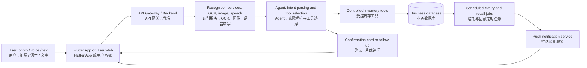

# CS734 Project Scope Draft: SayFridge Smart Household Inventory Assistant / CS734 项目范围草案：SayFridge 智能家庭库存助手

> Version / 版本：v0.1  
> Positioning / 定位：A household inventory assistant for individuals and families to manage food, fresh produce, and everyday supplies. / 面向个人及家庭用户的食品、生鲜与日用品库存管理助手。

## 1. Project Overview / 项目概述

SayFridge is an application consisting of a cross-platform mobile app, a user-facing web application, and an administrator web portal. It helps users build and maintain a household inventory with minimal manual entry, and proactively reminds them about expired or soon-to-expire items and missing consumption records.

SayFridge 由跨平台手机 App、用户 Web 和管理员 Web 组成，帮助用户以较低输入成本建立和维护家庭库存，并主动提醒已过期、即将过期的物品及可能遗漏的消耗记录。

Instead of requiring complex forms, users can photograph purchased items, receipts, or invoices; describe purchases or consumption by voice or text; manually correct inventory when needed; and receive scheduled reminders.

系统不要求用户填写复杂表单。用户可以拍摄购买物品、购物小票或发票；通过语音或文字描述购买与消耗；在需要时手动修正库存；并接收定时提醒。

The core Agent interprets multimodal inputs and chooses controlled backend tools, such as creating inventory records, recording consumption, or querying expiry status. The Agent **never accesses the database directly**. Every tool invocation is validated, authorised, executed transactionally, and audited by the backend.

核心 Agent 负责理解多模态输入并选择受控的后端工具，例如创建库存记录、记录消耗或查询临期状态。Agent **不直接访问数据库**；每一次工具调用都由后端完成参数校验、权限校验、事务执行和审计。

## 2. Target Users and Scenarios / 目标用户与使用场景

### 2.1 Target users / 目标用户

| User type / 用户类型 | Needs and pain points / 需求与痛点 | Primary platforms / 主要使用端 |
| --- | --- | --- |
| Individual user / 个人用户 | Forgetting what is already at home, food waste from expiry, difficulty maintaining records / 忘记家中已有物品、食品过期浪费、难以持续记录 | Mobile app first; web as a companion / 手机为主，Web 为辅 |
| Administrator / 系统管理员 | Managing accounts, handling abnormal tasks, and monitoring system operation and audits / 维护账户、处理异常任务、监控系统运行与审计 | Administrator web only / 仅管理员 Web |

The MVP targets individual users. Each account may create multiple flat storage spaces, such as fridges, freezers, and warehouses. The first release does not support nested spaces or inventory sharing between users.

MVP 面向个人用户。每个账户可以建立冰箱、冷柜、仓库等多个平级存储空间；首轮不支持空间嵌套或用户之间共享库存。

### 2.2 Typical scenarios / 典型场景

1. **Initial inventory setup / 首次建库**: The user photographs newly purchased items and their receipt. The system extracts candidate items, quantities, and dates, then asks the user to confirm before creating inventory records. / 用户拍摄刚购买的物品及小票；系统提取候选物品、数量和日期，用户确认后批量入库。
2. **Daily stock-in / 日常入库**: The user says, “I bought two cartons of milk and one bag of rice.” Speech is transcribed, structured information is extracted, and a confirmation card is shown before the data is saved. / 用户说“我买了两盒牛奶和一袋米”；系统转写并提取结构化信息，展示确认卡片后保存。
3. **Daily consumption / 日常消耗**: The user says, “We used three eggs and finished one carton of milk.” The system proposes deductions, normally prioritising the earliest-expiring batch, and allows correction. / 用户说“晚饭用了三个鸡蛋，喝掉一盒牛奶”；系统建议扣减库存，默认优先消耗最早到期批次，并允许修正。
4. **Expiry handling / 临期处理**: At 9:00 AM, the system sends a summary of expired and soon-to-expire food. Users can mark an item as consumed, discarded, or view details. / 每日早上 9 点，系统推送已过期和即将过期食品摘要；用户可标记“已食用”“已丢弃”或查看详情。
5. **End-of-day recall / 回顾式记录**: At 9:00 PM, the system gently prompts the user to recall today's usage, either through a guided category-by-category flow or a single free-form statement. / 每日晚上 9 点，系统提醒用户回顾当天使用情况；用户可按类别逐步记录，也可直接自由输入。
6. **Web management / Web 管理**: Users use a desktop browser for bulk viewing, filtering, and editing current inventory; administrators handle system-level exceptions and operations. / 用户在电脑上批量查看、筛选和编辑当前库存；管理员处理系统级异常与运营工作。

## 3. Product Scope / 产品范围

### 3.1 MVP features / MVP 必做功能

| Module / 模块 | Scope / 功能范围 |
| --- | --- |
| Accounts and personal inventory / 账户与个人库存 | Registration/login, profile, personal inventory, and access isolation by authenticated user / 注册登录、用户资料、个人库存、按认证用户进行权限隔离 |
| Inventory management / 库存管理 | Create, view, edit, and delete items; quantity, unit, category, purchase date, expiry date, storage location, and notes / 物品增删改查；数量、单位、类别、购买日期、到期日、储存位置和备注 |
| Multimodal input / 多模态录入 | Camera/image upload, receipt or invoice OCR, product-image recognition, voice input, and text input / 拍照上传、小票或发票 OCR、商品图像识别、语音与文字输入 |
| Agent assistant / Agent 助手 | Intent parsing, controlled tool use, and explicit confirmation for missing, uncertain, or consequential information / 意图解析、受控工具调用；信息缺失、低置信度或会影响库存时须确认 |
| Reminders / 提醒机制 | 09:00 expiry reminder, 21:00 daily-recall reminder, and configurable schedule/on-off preferences / 09:00 临期提醒、21:00 使用情况回顾提醒、可配置时间与开关 |
| User mobile app / 用户手机 App | Inventory overview, camera, voice/text entry, push notifications, item details, and manual maintenance / 库存概览、相机、语音/文字录入、推送、详情与手动维护 |
| User web / 用户 Web | Shared inventory data with the app; large-screen browsing, filtering, and bulk editing / 与手机端共享数据；大屏浏览、筛选和批量编辑 |
| Administrator web / 管理员 Web | Account status, task/recognition failures, restricted exception handling, and basic audit views / 账户状态、任务与识别失败记录、受控异常处理、基础审计查看 |
| Testing and security / 测试与安全 | Automated tests, device/emulator testing, API controls, and audit trails for sensitive actions / 自动化测试、真机/模拟器测试、API 安全控制和关键操作审计 |

### 3.2 Explicitly out of scope for the first MVP / 明确不在首轮 MVP 的范围SayFridge 非 Agent API 实施计划

## 1. 范围调整

采用上一版确认的业务范围，并删除以下接口：

- `PATCH /users/me`
- `PUT /users/me/avatar`
- `DELETE /users/me/avatar`

不增加昵称、头像字段及文件上传存储。保留改密码。

时区放进提醒设置，由 `GET/PATCH /users/me/reminder-settings` 读取和修改，供临期统计和定时提醒共用；默认 `Pacific/Auckland`，允许设置其他有效 IANA 时区。

本轮实现：

| 模块 | 接口及功能 |
|---|---|
| 认证 | 保留注册、登录、当前用户查询；新增 `POST /auth/change-password` |
| 存储空间 | `/storage-spaces` 列表、创建；`/{id}` 详情、编辑；`/{id}/archive`、`/{id}/restore` 归档与恢复 |
| 品类 | `GET /item-categories`，供入库选择和库存筛选 |
| 私有物品词典 | `/item-definitions` 查询、创建；`/{id}` 详情、编辑；归档、恢复 |
| 库存 | `/inventory-items` 查询、入库；`/{id}` 详情、编辑；`/{id}/archive` 归档 |
| 数量操作 | `POST /inventory-items/{id}/operation-preview` 预览；`POST /inventory-items/{id}/operations` 正式增加、消耗、盘点、丢弃 |
| 历史 | 查询单件库存操作、全部操作及单条操作详情 |
| 批量 | `batch-create`、`batch-move`、`batch-archive`，分别用于批量入库、移动和归档 |
| 概览 | `GET /inventory-summary`、`GET /expiry-summary` |
| 提醒设置 | `GET/PATCH /users/me/reminder-settings` |
| 推送设备 | `PUT/DELETE /users/me/push-devices/{installation_id}` |
| 站内通知 | 查询列表、未读数量、标记单条及全部已读 |
| 管理员 | 用户列表及详情、修改普通用户状态；公共品类和物品词典管理；审计列表及详情 |

除 `/health` 外，路径统一以 `/api/v1` 开头。

不实现 Agent、识别、对话、任务调度、用户记忆、历史重估及撤回。手动纠错通过增加或重新盘点完成，保留原历史。

## 2. 文件组织与可读性

按功能组织，**不按每个 API 创建一个文件，也不把所有 API 放进同一个文件**。

```text
backend/
├── app/
│   ├── main.py                 # 创建应用，统一挂载 API
│   ├── api/
│   │   ├── router.py           # 汇总所有功能路由
│   │   ├── dependencies.py     # 当前用户、管理员等共同依赖
│   │   └── routes/             # auth、storage_spaces、catalog、
│   │                          # inventory、inventory_operations、
│   │                          # reminders、notifications、admin
│   ├── schemas/               # 各模块请求与响应模型
│   ├── services/              # 对应模块的计算、权限与事务逻辑
│   ├── workers/               # 提醒调度、通知投递
│   └── db/                    # ORM 模型及数据库连接
├── migrations/                # 本次新增迁移
└── tests/                     # 按业务模块组织测试
```

调用关系：

**请求 → 功能路由 → 业务服务 → 数据库 → 明确的响应模型。**

- `main.py` 只挂载总路由，不堆业务逻辑。
- 路由负责参数、身份依赖、调用服务和返回 HTTP 响应。
- 服务负责计算和事务，供手动操作及未来 Agent 共用。
- 批量接口复用单件操作的业务规则，事务由批量服务统一控制。
- 暂不添加通用 Repository 层；出现实际重复需求再引入。
- 每个 API 编写简洁的中英文 `summary`、说明和必要字段描述，显示在 Swagger 中。
- 注释解释数量状态、权限和事务等容易误解的规则，不逐行复述代码。

由于本轮包含数据库扩展、后台提醒和测试，实际会新增多个文件，并修改少量现有入口、认证、配置与模型文件；不为减少文件数量牺牲职责划分。

## 3. 业务规则与数据变更

- 支持多个平级空间，不支持共享或嵌套；存在在库物品的空间不能归档。
- 公共词典由管理员维护；普通用户仅维护自己的私有词典。
- 新购批次独立入库，不自动合并；首次入库数量保持不变。
- 普通库存编辑只能修改物品关联、日期、空间和备注，不能绕过操作接口直接修改数量。
- 数量使用 `Decimal`，API 使用最多三位小数的十进制字符串；支持同单位和 `g/kg`、`ml/l` 确定性换算。
- 有估算余额时，后续普通增减继续作用于估算；盘点更新确认余额并清空估算。
- 预览不写数据；正式提交重新计算，校验版本和幂等键，库存与历史同事务提交。
- 区分消耗、丢弃和归档；记录首次入库、数量操作、资料修改及归档的前后状态。
- 批量最多 100 条，全部成功或全部失败；失败响应指出条目位置与原因。
- 列表统一分页，默认 20 条、最多 100 条；库存默认按批次展示。
- 提醒默认当地时间 09:00 临期、21:00 回顾，临期阈值 3 天，可修改或关闭。
- 后台先保存站内通知，再推送；同一用户、提醒类型和当地日期不重复生成。
- 手机推送默认采用 FCM；实际设备验证需要可用的 Firebase/APNs 配置。
- 管理员只管理普通用户状态与公共词典，不提供私人库存或对话读取接口；管理写入同步记录审计。

新增迁移包括：库存备注、操作历史扩展、请求幂等记录、提醒设置、推送设备、通知及投递记录、管理审计，以及使改密码后旧令牌失效的用户令牌版本。保留现有数据，不重写初始迁移。

## 4. 前端 API 文档交付

新增 [API_REFERENCE.md](D:/project-implementation-appix/docs/API_REFERENCE.md)，提供完整前端接入说明；同步更新后端 README 的启动、迁移及提醒任务运行方法。

文档必须包含：

- 服务地址、`/api/v1` 前缀、Bearer Token 使用方式。
- 每个接口的方法、路径、中英文用途、权限要求。
- 路径参数、查询参数、请求字段、必填项、默认值和枚举。
- 成功响应、错误响应及可复制的请求示例。
- 数量字符串、日期、时区、分页和状态的统一约定。
- `expected_version` 与 `Idempotency-Key` 的具体使用方式。
- 新建空间和物品、入库、预览与确认消耗、盘点、查看历史的完整调用示例。
- 批量失败、版本冲突、令牌失效、未知单位等前端处理方式。
- 提醒设置、设备绑定、通知已读和管理员调用示例。
- 已实现能力与需要外部推送配置才能验证的能力。

同时交付与代码一致的 `/docs`、`/redoc`、`/openapi.json`，避免文档和实现各写一套。

## 5. 验收与完成汇报

使用 Python 3.11 执行后端测试，重点验证权限隔离、数量计算、操作历史、事务回滚、重复提交、并发冲突、批量原子性、改密码失效、提醒去重和管理员审计。

验证迁移能够应用，已有认证仍可使用，完整手动库存流程无需任何 AI 服务。

本轮仅实现后端和文档，不修改前端页面。实际推送在配置可用时做设备验证；否则明确报告尚未验证，不以模拟测试代替真实投递结论。

完成后向你汇报：

1. 已实现哪些 API，以及未完成或受外部配置影响的部分。
2. 实际新增、修改的文件及各自职责。
3. 运行过的测试与结果。
4. 启动服务、迁移数据库和运行提醒任务的方法。
5. 完整 API 文档位置与 Swagger 访问方式。


- Real supermarket ordering, payment, delivery, or retailer-inventory integration / 自动下单、支付、配送或对接超市真实库存。
- OCR or image recognition that changes inventory without any user confirmation / 无需用户确认即可修改库存的全自动 OCR 或图像识别。
- Medical or nutritional advice, or definitive food-safety judgement / 医疗、营养建议或食品安全责任判断。
- Smart-fridge hardware, IoT sensors, Bluetooth, or NFC device integration / 智能冰箱硬件、IoT 传感器、蓝牙或 NFC 设备接入。
- Multiple inventory spaces, shared inventory, fine-grained roles, or social features / 多库存空间、用户共享库存、细粒度角色体系或社交功能。
- Fully automatic long-term consumption prediction or generative recipe recommendations / 全自动长期消耗预测或生成式食谱推荐。

These may become stretch goals, but must not delay the MVP's core flow. / 它们可作为 Stretch Goals，但不能阻碍 MVP 主链路完成。

## 4. Responsibilities of the Three Frontends / 三端职责与双端存在理由

| Platform / 端 | User / 用户 | Main responsibility / 核心职责 | Why it is distinct / 不可替代的原因 |
| --- | --- | --- | --- |
| Flutter mobile app / Flutter 手机 App | General user / 普通用户 | Photography, voice entry, push notifications, and quick recording / 拍照、语音、推送与快速记录 | Direct access to camera, microphone, native notifications, and convenient use while shopping or cooking / 直接使用摄像头、麦克风和原生推送，适合购物和厨房场景 |
| User web / 用户 Web | General user / 普通用户 | Large-screen inventory viewing, advanced filters, and bulk editing / 大屏库存浏览、复杂筛选和批量编辑 | Better for organising larger datasets and completing longer editing tasks / 适合整理较多数据，降低手机端表单负担 |
| Administrator web / 管理员 Web | Administrator / 管理员 | Account, task, audit, and exception management / 用户、任务、审计和异常管理 | Administrative work needs desktop efficiency and restricted permissions, not a consumer mobile experience / 管理操作需要桌面效率和受限后台权限，不应放入普通用户 App |

The mobile app and user web share core business data but serve different contexts and tasks; they are not merely duplicated interfaces.

手机端和用户 Web 共享核心业务数据，却服务于不同场景和任务，因此并非简单重复。

## 5. Core Workflow / 核心业务流程



### 5.1 Stock-in flow / 入库流程

1. The user uploads a photo/receipt or describes a purchase by voice or text. / 用户上传物品照片、小票，或用语音、文字描述购买内容。
2. The backend stores the original input and invokes OCR, image recognition, or speech transcription. / 后端保存原始输入并调用 OCR、图像识别或语音转写。
3. The Agent converts results into a candidate operation, such as `add_inventory_item`. / Agent 将结果转换成候选操作，例如 `add_inventory_item`。
4. The frontend presents a confirmation card containing item name, quantity, unit, expiry date, and other fields. Missing or low-confidence fields require user input or confirmation. / 前端展示物品名称、数量、单位、到期日等确认卡片；缺失或低置信度字段必须由用户补充或确认。
5. After confirmation, the backend creates or updates current inventory within a database transaction. / 用户确认后，后端在数据库事务中写入或更新当前库存。

### 5.2 Consumption flow / 消耗流程

1. The user says or enters, “Used three eggs.” / 用户说或输入“用了三个鸡蛋”。
2. The Agent calls a query tool to locate plausible inventory batches. / Agent 调用查询工具定位可能的库存批次。
3. If there are multiple batches, the system suggests consuming the earliest-expiring batch first and shows the choice. / 如果有多个批次，系统默认建议优先扣减最早到期批次，并展示选择。
4. On confirmation, the backend reduces stock. A zero-quantity item is marked as consumed and is hidden from the current in-stock list. / 确认后后端扣减库存；数量归零的物品标记为已用完，不显示在当前在库列表。

### 5.3 Scheduled reminders / 每日提醒流程

- **09:00 AM / 早上 09:00**: A background job finds expired and soon-to-expire food/fresh items, generates a summary, and sends a notification. The default threshold (for example, three days) is still to be decided. / 后台任务查询已过期和未来 N 天内到期的食品/生鲜，生成摘要并推送；默认阈值（如 3 天）待小组确定。
- **09:00 PM / 晚上 21:00**: A lightweight prompt invites the user to record today's consumption. The user may follow a guided flow, skip it, or enter a free-form statement. / 轻量提醒邀请用户记录当天消耗；用户可按引导完成、跳过或自由输入。
- Users can turn reminders off or change the schedule. Duplicate notifications for the same event must be prevented. / 用户可关闭提醒或调整时间；同一事件必须避免重复推送。

## 6. Agent and Tool Boundaries / Agent 与工具边界

The Agent's job is interpretation and orchestration, not database ownership. The following minimum tool set is proposed. / Agent 的职责是理解和编排，而非拥有数据库权限。建议最小工具集如下：

| Tool / 工具 | Purpose / 用途 | Safety and business constraints / 安全与业务约束 |
| --- | --- | --- |
| `search_inventory` | Query a user's inventory by name, category, or state / 按名称、类别、状态查询库存 | Derive `userId` from authenticated identity / 强制从认证身份获取 `userId` |
| `create_inventory_draft` | Create a proposed stock-in item / 创建待确认的入库候选项 | Does not take effect immediately; retains source and confidence / 不直接生效；保存来源与置信度 |
| `confirm_inventory_draft` | Confirm a proposal and formally add stock / 确认候选项并正式入库 | Requires explicit confirmation and server-side field validation / 必须用户确认，且服务端校验字段 |
| `record_consumption` | Record consumption and reduce stock / 记录消耗、减少库存 | Never allow negative quantity; batch selection must be traceable / 不允许负库存，批次选择可追溯 |
| `update_inventory_item` | Correct quantity, date, location, etc. / 更正数量、日期、位置等 | Field allowlist, authorisation, and audit / 字段白名单、权限校验、审计 |
| `delete_inventory_item` | Remove or archive an erroneous item / 删除或归档错误记录 | Second confirmation or soft delete, plus audit / 二次确认或软删除及审计 |
| `get_expiry_summary` | Retrieve expiry summary / 获取临期和过期摘要 | Return only data visible to the current user / 仅返回当前用户可见数据 |

For consequential actions, use a **draft first, user confirmation second** pattern. Model output must conform to a structured schema; the backend must never concatenate model text into SQL or execute arbitrary commands.

对高影响操作采用“**先生成草稿，再由用户确认执行**”的模式。模型输出必须遵循结构化 schema；后端绝不能将模型文本拼接为 SQL 或执行任意命令。

## 7. Current Basic Data Model / 当前数据库基础模型

The MVP currently designs eight tables: user, storage_space, item_category, item_definition, inventory_item, inventory_operation, conversation, and conversation_message. See [`DATABASE_DESIGN.md`](./DATABASE_DESIGN.md) for the complete fields, constraints, and explicit non-goals. / MVP 当前设计八张表：user、storage_space、item_category、item_definition、inventory_item、inventory_operation、conversation、conversation_message。完整字段、约束和不建表边界见 [`DATABASE_DESIGN.md`](./DATABASE_DESIGN.md)。

| Entity / 实体 | Key fields / 关键字段 | Description / 说明 |
| --- | --- | --- |
| User / 用户 | id, email, passwordHash/authProvider, role, voiceLimitSeconds, voiceUsedSeconds, voiceQuotaResetAt | User account and current voice-call quota / 用户账户和当前语音通话额度 |
| StorageSpace / 存储空间 | id, userId, name, type, status | One flat storage space owned by the user / 用户拥有的一个平级存储空间 |
| ItemCategory / 物品品类 | id, name, normalizedName, status | Shared category dictionary, such as vegetables, dairy, and household supplies / 公共品类词典，例如蔬菜、乳制品和日用品 |
| ItemDefinition / 物品定义 | id, name, normalizedName, categoryId, ownerUserId, status | Shared or user-private item definition; a null ownerUserId means shared / 公共或用户私有的物品定义；ownerUserId 为空表示公共 |
| InventoryItem / 库存物品 | id, storageSpaceId, itemDefinitionId, initialAmount/unit, confirmedCurrentAmount/unit, estimatedCurrentAmount/unit, version | Concrete inventory with a confirmed baseline and an optional estimate overlay / 具有确认基线和可选估算覆盖层的具体库存 |
| InventoryOperation / 库存操作 | id, inventoryItemId, operationType, affectsState, inputMethod, quantityValue/unit, calculationMethod, appliedChangeAmount/unit, status | A single-item AI or manual change, reconciliation, and reversal basis / 单物品的 AI 或手动变更、重新确认与撤回依据 |
| Conversation / 会话 | id, userId, title, createdAt, updatedAt | One multi-turn conversation / 一次多轮对话 |
| ConversationMessage / 会话消息 | id, conversationId, role, content, createdAt | One message in a conversation / 会话中的单条消息 |

`Household` and a generic `InventoryTransaction` are not created. Users manage multiple flat spaces through `StorageSpace`, without sharing. `InventoryOperation` stores single-item AI and manual operations; a user reconciliation creates a new confirmed baseline and clears the active estimate. Conversation history remains independent from inventory-operation history, and database transactions keep inventory and operation writes atomic. / 当前不建立 `Household` 或通用 `InventoryTransaction`。用户通过 `StorageSpace` 管理多个平级空间但不共享；`InventoryOperation` 保存单物品 AI 和手动操作；用户重新盘点会建立新的确认基线并清空当前估算。对话历史与库存操作历史保持独立，数据库事务保证库存和操作记录同时成功或同时失败。

## 8. Proposed Architecture and Protocols / 技术架构与通信协议（建议）

- **Mobile / 移动端**: Flutter for Android and iOS, using camera, image picker, microphone, gestures, and local/remote notifications. / Flutter 支持 Android 与 iOS，使用相机、图片选择、麦克风、手势和本地/远程推送。
- **Web / Web 前端**: User and administrator web interfaces may share a technology stack, while routes, permissions, and interfaces remain separated by role. / 用户 Web 和管理员 Web 可共用技术栈，但按角色隔离路由、权限与界面。
- **Backend/API Gateway / 后端/API 网关**: Central authentication, rate limiting, input validation, routing, and auditing; versioned REST APIs for clients. / 统一认证、限流、输入校验、路由与审计；对客户端提供版本化 REST API。
- **Business services / 业务服务**: Inventory, identity/access, reminders, media processing, and Agent orchestration are modular. Start as a modular monolith, while keeping service boundaries clear. / 库存、身份权限、提醒、媒体处理和 Agent 编排模块化；首版可采用模块化单体，但保持清晰服务边界。
- **Data and media / 数据与媒体**: Use a relational database for business data and object storage for receipts, images, and audio. / 关系型数据库保存业务数据；对象存储保存小票、图片和音频。
- **Async work / 异步任务**: A queue and scheduler handle OCR, image recognition, speech transcription, and notifications without blocking CRUD requests. / 通过消息队列和调度器处理 OCR、图像识别、语音转写和推送，避免阻塞 CRUD 请求。

| Communication scenario / 通信场景 | Protocol / 协议 | Justification / 理由 |
| --- | --- | --- |
| App/web to backend / App、Web 与后端 | HTTPS REST + JSON | Clear resource model, mature cross-platform support, and easy testing/access control / 资源模型清晰、跨平台成熟、便于测试和权限控制 |
| Image/audio upload / 图片、音频上传 | HTTPS multipart or presigned object-storage upload / HTTPS multipart 或预签名对象存储上传 | Supports larger files without keeping API connections busy / 支持大文件，避免 API 长时间承载媒体流 |
| Long-running task status / 长任务状态 | REST polling for MVP; WebSocket/SSE later / MVP 用 REST 轮询；后续可用 WebSocket/SSE | AI jobs are asynchronous; MVP is simpler and stable, with a path to higher real-time responsiveness / AI 任务异步；MVP 更稳定简单，后续可升级实时性 |
| Backend to notification provider / 后端至推送服务 | Platform push API / 平台推送 API | Uses operating-system notification channels on Android and iOS / 使用 Android、iOS 系统通知通道 |

## 9. Scalability / 可扩展性设计

- Keep API services stateless so they can scale horizontally behind a load balancer. / API 服务保持无状态，可在负载均衡后横向扩展。
- Put image, OCR, speech, and Agent work into asynchronous queues and independent workers. / 图像、OCR、语音和 Agent 请求进入异步队列，由独立 worker 消费。
- Store media in object storage rather than the database, using CDN and lifecycle policies when needed. / 媒体文件进入对象存储而非数据库，必要时采用 CDN 与生命周期策略。
- Design database access and indexes around `userId`, current-inventory queries, and expiry checks. / 围绕 `userId`、当前库存查询和到期检查设计访问控制与索引。
- Apply timeout, retry, rate-limit, and degradation strategies to external AI services; manual data entry remains available when AI is unavailable. / 对外部 AI 服务设置超时、重试、限流和降级策略；AI 不可用时仍可手动录入。
- Make reminder jobs idempotent: a user should receive at most one successful notification of a given type per day. / 提醒任务必须幂等：同一用户、同种提醒、同一天最多成功发送一次。

## 10. Testing Strategy / 测试策略

| Test level / 层级 | Coverage / 覆盖内容 | Example / 示例 |
| --- | --- | --- |
| Unit tests / 单元测试 | Flutter state/components, backend services, and Agent tool validation / Flutter 状态/组件、后端服务、Agent 工具参数校验 | Expiry calculation; quantity cannot become negative; intent-to-tool mapping / 到期计算、库存不可为负、意图到工具映射 |
| API/integration tests / API 与集成测试 | Authentication, isolation, inventory transactions, media callbacks / 认证、权限隔离、库存事务、媒体回调 | User A cannot read User B's inventory; a draft creates stock only after confirmation / A 用户不能读 B 的库存；草稿确认后才入库 |
| Agent contract tests / Agent 合约测试 | Fixed inputs, structured-output schema, tool allowlist / 固定输入集、结构化输出 schema、工具白名单 | “Used two eggs” yields only a valid consumption draft / “用了两个鸡蛋”仅产生合法消耗草稿 |
| UI/end-to-end tests / UI 与端到端测试 | Critical app and web journeys / App、Web 关键路径 | Register, photo stock-in, confirm, expiry view, manual correction / 注册、拍照入库、确认、查看临期、手动更正 |
| Device/emulator tests / 真机与模拟器测试 | Android/iOS camera, microphone, permissions, notifications / Android/iOS 相机、麦克风、权限和推送 | A user declining microphone permission can still use text input / 拒绝麦克风后仍可文字输入 |
| Performance/reliability tests / 性能与可靠性测试 | Concurrent API requests, bulk upload, scheduled jobs, queue backlog / 并发 API、批量上传、定时任务、队列积压 | Inventory remains queryable during peak load and reminders are deduplicated / 高峰下仍可查库存且提醒不重复 |
| Security tests / 安全测试 | Authorisation, validation, upload controls, relevant OWASP risks / 鉴权、输入校验、上传限制、相关 OWASP 风险 | Broken access control, malicious file, injection, rate limiting / 越权、恶意文件、注入、限流 |

The final demonstration should include at least one complete path: photo or voice input on a real/simulated device → confirmation → stock-in or consumption → synchronised web view → expiry notification.

最终演示至少展示一条完整主线：真实或模拟设备上的照片/语音输入 → 确认 → 入库或消耗 → Web 同步显示 → 到期提醒。

## 11. Cybersecurity and Privacy / 网络安全与隐私

The OWASP Top Ten will be used as a baseline. At minimum, the system will address the following. / 以 OWASP Top Ten 为检查基线，系统至少处理以下问题：

- **Broken access control / 访问控制失效**: Filter every inventory query and mutation by the `userId` derived from authenticated identity; separate administrator and ordinary-user permissions. / 所有库存读写均按认证身份得到的 `userId` 过滤；管理员与普通用户权限分离。
- **Authentication/session risks / 认证与会话风险**: Secure password storage, HTTPS, short-lived access tokens or secure refresh mechanisms, and login rate limits. / 密码安全存储、HTTPS、短期访问令牌或安全刷新机制、登录限流。
- **Injection and validation / 注入与输入校验**: Parameterised database access and schema validation for API input, tool arguments, and file metadata. / 参数化数据库访问；对 API 输入、工具参数和文件元数据进行 schema 校验。
- **Insecure design and AI risks / 不安全设计与 AI 风险**: Allowlisted tools, least privilege, confirmation before writes, and protection against prompt injection crossing permission boundaries. / 工具白名单、最小权限、写前确认，并防止提示词注入突破权限边界。
- **File-upload risks / 文件上传风险**: Restrict MIME type, size, and quantity; scan when feasible; never trust user-provided filenames. / 限制 MIME 类型、大小、数量；条件允许时扫描；不信任用户文件名。
- **Sensitive-data exposure / 敏感数据暴露**: Private media storage with short-lived access URLs; logs must not retain passwords, tokens, or unnecessary receipt content. / 媒体私有存储与短期访问链接；日志不记录密码、令牌或非必要票据内容。
- **Insufficient logging/monitoring / 日志与监控不足**: Record login, access failures, sensitive inventory changes, admin actions, and Agent tool outcomes without excessive data collection. / 记录登录、权限失败、敏感库存变更、管理员操作和 Agent 工具结果，同时避免过度收集。

## 12. Decisions Still Needed / 待小组确认的问题

1. What is the default “soon to expire” threshold, and should it vary by category? / “临期”默认阈值是几天，是否按类别不同？
2. Which cloud/model services will perform receipt, image, and speech recognition, and is a controlled mock fallback acceptable for the course demo? / 小票、图像、语音识别使用哪些云服务或模型；课程演示是否允许受控模拟结果作为备选？
3. When an expiry date cannot be read, should the user enter it, should the system infer a default, or should it remain unknown? / 到期日无法识别时，用户手填、系统规则推断，还是标记为未知？
4. Does initial setup cover only newly purchased items, or also loose/existing household items without a receipt? / 初始建库仅覆盖新购买物品，还是也支持无小票的家中散装/既有物品？
5. Should administrators access raw user images/audio, or only de-identified task status and error information? / 管理员是否可查看用户原始图片/语音，还是只能看脱敏任务状态和错误信息？
6. Which demo flow is the highest priority: receipt/photo stock-in, or voice consumption recording plus reminders? / 演示优先保证哪条主线：小票/拍照入库，还是语音消耗记录加智能提醒？

## 13. Recommended Next Outputs / 建议的后续产出

1. Confirm the open questions and freeze the MVP scope. / 确认待决问题并冻结 MVP 范围。
2. Produce a deployment/architecture diagram covering users, app, user web, admin web, API, Agent, database, and notification service. / 绘制涵盖用户、App、用户 Web、管理员 Web、API、Agent、数据库和通知服务的部署/架构图。
3. Break the MVP into user stories, API contracts, database schema, and iterations. / 将 MVP 拆成 user stories、接口契约、数据库 schema 和迭代计划。
4. Build the smallest end-to-end loop first: voice/text consumption → confirmation → inventory change; then integrate photo, receipt, and reminders. / 优先完成最小端到端闭环：语音/文字消耗 → 确认 → 库存变化；之后接入拍照、小票和提醒。
