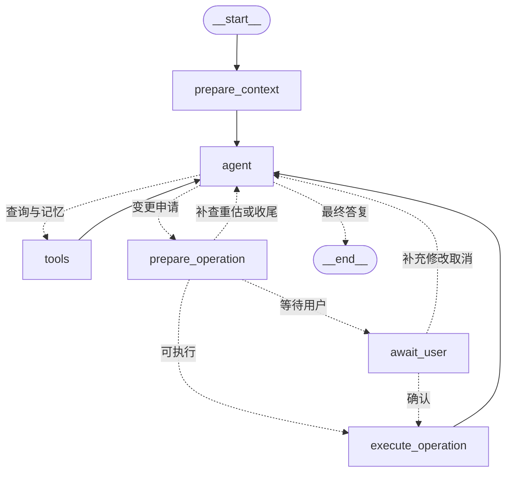

# SayFridge 当前系统架构

> 状态：在 Agent V0.2 六节点实现上增加统一图文输入和图片入库核对。代码与本地验收不等于已部署到远程环境。
>
> 旧 Realtime、LiveKit 和双 Agent 方案已归档为[历史目标架构](../archive/2026-09-25/ARCHITECTURE_REALTIME_DRAFT.md)，不作为当前实施要求。

## 1. 组件与维护边界

Web 和 Flutter 通过 FastAPI 访问业务能力；图文 Agent 也运行在后端。
Graph 调用后端业务服务，复用身份、归属、数量、状态和事务规则。
模型负责理解请求、查找信息和提出估算；最终余额及正式写入由后端计算和校验。

| 组件 | 当前职责 | 主要依据 |
| --- | --- | --- |
| Web / Flutter | 请求、展示及提交用户选择；具体页面完成度以各组件为准 | [产品范围](../product/README.md) |
| FastAPI 路由 | 登录认证、请求校验、HTTP/SSE、会话恢复 | [API 参考](../reference/API_REFERENCE.md) |
| 后端业务服务 | 所有权、状态、数量计算、版本检查、事务与幂等 | [后端设计](BACKEND_DESIGN.md) |
| LangGraph | 一名业务 Agent 的六节点流程、待处理项目与暂停恢复 | 本文 |
| PostgreSQL | 业务数据、执行凭据、检查点和用户记忆 | [数据库设计](DATABASE_DESIGN.md) |

当前 Agent 支持查询、首次入库、增加、消耗、盘点和显式记忆维护。
同一个多模态模型直接理解图文，不新增独立识别服务或节点。图片支持问答和新批次入库，
所有图片入库候选均需用户核对。语音由前端转文字，后端不接收音频。
主动通知、撤回、历史重估和独立任务队列不属于当前实现。

图文消息、附件限制和补图接口见 [API 参考](../reference/API_REFERENCE.md#multimodal-messages-and-frontend-contract)，
前端任务见 [接入清单](../reference/AGENT_FRONTEND_INTEGRATION.md)。图片保存在会话检查点中，来源 ID
和摘要随候选传递；原始图片不进入业务执行凭据。历史图片继续参与模型上下文，因此
即使后续文字入库未显式引用图片，只要模型仍可见历史图片，也会保守要求核对。

## 2. 六节点 Graph

入口是 `__start__ -> prepare_context -> agent`。下面保留主路径；模型修正申请格式时还可以在 agent 内重新生成申请。



| 节点 | 当前功能 |
| --- | --- |
| prepare_context | 加载用户空间摘要与记忆；结构化识别当前意图，将库存请求的全部项目保存为未完成草稿 |
| agent | 补齐已识别项目、调用工具和提出估算；查询由模型回答，库存完成通知由后端根据实际结果生成 |
| tools | 调用查询、匹配和显式记忆维护工具 |
| prepare_operation | 校验目标与输入，检查适用记忆，调用后端计算预览，分类可执行或待处理项目 |
| await_user | 将有效候选与问题保存到 Checkpoint 后暂停，处理结构化用户回复 |
| execute_operation | 每项调用独立后端事务，返回实际结果、冲突或待核实状态 |

节点与模型工具属于两个层次。模型调用 `propose_inventory_actions` 时，
agent 保存申请并将流程转向 prepare_operation；它不由通用 tools 节点直接执行。
prepare_operation 和 execute_operation 都是普通 Python 节点，调用业务服务，不是额外模型。

prepare_context 使用同一配置模型的一次 `record_turn_intent` 结构化调用；只记录当前请求中的事实，不生成数据库 ID 或执行写入。查询、否定写入、假设性问题和图片用途不明不会自动变成库存动作。库存草稿在模型查询前保存，后续只修订稳定的 item_key。补充已有项目直接恢复，不重复识别整段历史。

格式不合法最多纠正两次，持续失败保留可恢复现场；模型只输出文字不能结束已有未完成项目，最多纠正两次后进入准备和待补充。实际意图识别仍依赖模型，需要真实模型验收。


## 3. 模型可用的工具

| 工具 | 用途 |
| --- | --- |
| list_storage_spaces | 查询用户空间 |
| list_inventory | 筛选和分页查询库存 |
| get_inventory_detail | 查询具体批次 |
| get_expiry_summary | 根据客户端提供的当地日期查询临期情况 |
| resolve_inventory_targets | 按正式名称、别名、名称片段及模型提供的查询说法找到真实候选 |
| list_item_definitions | 查询公共和当前用户的私人物品定义 |
| list_item_categories | 查询已有公共品类 |
| search_user_memories | 继续查询当前用户的适用记忆 |
| save_user_memory | 根据用户明确要求保存或更新记忆 |
| delete_user_memory | 根据用户明确要求删除记忆 |
| propose_inventory_actions | 特殊变更申请入口，进入准备、确认和执行流程 |

共十个普通工具和一个特殊申请入口。所有目标必须来自当前用户可访问的真实记录。
同名批次无法唯一确定时返回候选；明确的最早到期偏好可以帮助选择，但并列时仍需用户选择。
当前没有结构化开封状态，不能将“优先已开封”描述为已经实现的自动选择规则。
名称与别名匹配不使用向量检索。

## 4. 用户记忆的访问与使用

长期记忆统一按用户放在 Store namespace：
`("users", authenticated_user_id, "memories")`。物品和空间是适用条件，
不为每件库存建立单独记忆库。用户身份由服务端认证取得，模型不能指定用户或 namespace。

| 类型 | 内容与用途 |
| --- | --- |
| UNIT_RELATIONSHIP | 经验单位关系及物品、空间、量具和时间条件，供估算使用 |
| USAGE_PREFERENCE | 用户明确的选择或展示偏好，例如最早到期批次 |
| ENTITY_ALIAS | 随意叫法与真实空间或物品定义 ID 的对应 |

记录使用版本化 JSON，并兼容读取旧格式。能够明确表达的换算使用十进制字符串，例如：

```json
{"source_amount":"1","source_unit":"cup","target_amount":"100","target_unit":"g"}
```

别名的结构化字段为 alias、target_type（SPACE 或 ITEM_DEFINITION）及 target_id；
保存前校验目标可见性。全局批次偏好可以使用
`{"batch_selection":"EARLIEST_EXPIRY"}`。

每轮按页读取用户记忆并缓存，向模型预加载最多 20 条、4,000 字符的相关内容。
截断会明确标记；目标确定后，准备服务仍完整检查物品、空间、源/目标单位、量具和日期条件，
不能把“预加载里没有”当作“用户没有记忆”。同轮只读工具循环复用缓存，记忆修改后失效。

稳定物品 ID 优先于旧显示名称；g/kg、ml/l 及标准中文单位名按已有规范匹配。
适用条件更具体的记忆优先；同等条件下相互矛盾则询问。缺少记忆所限定的量具或日期时，
先补充适用条件。用户本轮明确说明可以作为当前操作的依据，不会自动覆盖旧记忆。

没有适用记忆时，允许模型用自身知识提出 MODEL_KNOWLEDGE 估算。
读取失败重试一次，仍失败则保留受影响项目等待处理，不将失败解释成无记忆。
经验换算无论来自用户记忆还是模型知识，都不能自动升级为确定性换算。

保存、更新和删除需要当前用户的明确记忆指令及从该消息原文提取的 authorization_quote。
当前支持明确的中英文记忆表达（例如“记住”“remember”）；普通“好的”或估算确认不够。
重复内容去重；记忆变更使本轮相关缓存失效。取消库存候选不会撤销一次独立的显式记忆保存。

提交前检查引用记忆的内容指纹。记忆已变更或删除时重新准备候选。
正式执行凭据保存当时使用的依据快照，后续记忆更新不会重写旧库存操作。

## 5. 候选、人工介入与逐项提交

一轮最多处理 20 项。项目可分别成功、失败、取消或等待输入。
准备节点只计算预览；执行节点每项使用独立事务。
一项失败不回滚其他成功项目。手动 batch-create/move/archive 的整批原子性仍由其接口单独保证。

| 情况 | 当前处理 |
| --- | --- |
| 目标与确定性数量完整 | 准备后直接执行，不增加固定确认 |
| 初始数量缺失 | 请用户补充；“两袋”可直接按 2 袋记录，无需先估计重量 |
| 目标有歧义、记忆冲突或适用条件不足 | 集中询问必要信息，支持选择当前候选 |
| AI_ESTIMATED 候选 | 展示原话、估算依据和候选变化量，确认当前 proposal_id 后执行 |
| 图片或可见图片历史下的首次入库 | 展示来源、包装规格和实际数量，标记 IMAGE_REVIEW，确认当前候选后创建新批次 |
| 明确的新物品或用户明确指定的新空间 | 自动准备并随入库事务创建，不额外确认；不创建公共品类 |
| 修改候选 | 重新计算，旧候选失效 |
| 取消项目 | 仅取消该未执行项目；已成功项目不受影响 |

数量字段的更新规则只在[数量设计](QUANTITY_STATE_DESIGN.md)维护。
确认一次估算不等于盘点；RECONCILE 必须表示用户实际确认的剩余总量。
人工介入遵循明确分支，不能把“没有用户经验”作为禁止模型估算的理由。

清晰物品先查询并复用可见定义，没有匹配再使用真实有效分类创建私有定义。真正的身份/分类歧义通过 clarification_question 等待回答，不因首次出现就要求用户定义物品。

位置来自用户指定或适用的明确偏好，缺失或匹配有歧义时询问。新空间名称必须出现在本任务用户原话中；后端核对 new_space_source_text 的出处，不接受图片、工具或助手文字作为创建依据。物品、空间、库存与回执同事务提交，等待期间不提前创建。

库存成功/失败/取消通知由后端逐项依据实际结果生成，不再让模型重新解释完成状态；中英文通知保留实际数量、位置及估算标识。默认查询回复使用简短纯文本，只有不完整结果才提示分页。

Checkpoint 保存项目、候选、问题和执行进度。await_user 使用持久化 interrupt：
暂停后 HTTP 流结束，等待期间不保持业务事务；客户端通过 resume 接口回答，
并绑定当前 interrupt_id 和 proposal_id。客户端契约、状态与事件见
[API 参考第 9 节](../reference/API_REFERENCE.md#9-agent-v02--chat-resume-and-recovery)。

## 6. 持久化与恢复边界

| 数据 | 保存位置 | 权威含义 |
| --- | --- | --- |
| 当前库存与数量历史 | 业务表 | 实际业务状态 |
| 成功 Agent 动作及依据 | agent_inventory_action | 已提交结果及幂等凭据 |
| 跨会话用户知识 | PostgreSQL Store | 有适用条件的知识，不是库存事实 |
| 本轮执行进度与候选 | LangGraph Checkpointer | 恢复与等待现场，不替代业务凭据 |
| 临时检索缓存 | 请求运行时 | 减少重复读取，不持久保存连接或密钥 |

Checkpoint 使用同步持久化，写入前保存稳定的候选/动作标识。
同一项目的新空间、私人物品、库存变更和业务凭据在同一事务中提交或回滚；
成功创建的关联可由后续项目复用。Agent 数量历史使用 TEXT 来源，原始表达仍保留；
首次入库不伪造 ADD 历史。表字段由[数据库设计](DATABASE_DESIGN.md)维护。

重复提交先查业务凭据，再判断是否需要执行。业务已提交但 Checkpoint 尚未保存结果时，
恢复读取原结果，不再次扣减。版本或记忆变更会使旧候选失效；提交结果未知时，
保留原标识先核实，禁止更换标识绕过核实。

同会话跨进程互斥使用独立直连 PostgreSQL 会话的 advisory lock。
这条连接不占用 Checkpointer 池；流结束或暂停后释放锁，不在模型等待期间持有业务事务。

## 7. 当前状态与其他入口

Agent V0.2 已完成本地实现及记录在案的验收，证据见
[Agent 验收报告](../testing/reports/AGENT_V02_TEST_RESULTS.md)和[测试索引](../testing/README.md)。
验收报告是特定运行的证据，不代表每次代码变化都重新执行了全部测试。

远程部署必须单独检查 Agent schema 和业务执行凭据表。最近一次 V0.2 只读检查发现
远程缺少 agent_inventory_action；本文不宣称已经执行远程建表。
环境、Windows 事件循环、显式初始化及测试命令统一见
[后端 README](../../backend/README.md#agent-configuration-and-storage)。
