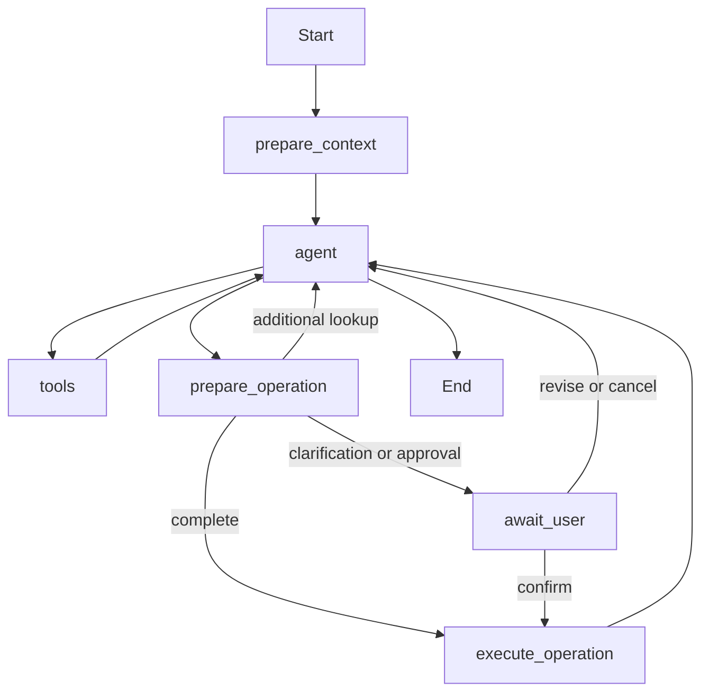

# Agent Design

The Agent interprets user input and calls backend services through an allowlist.
It does not own authentication or write arbitrary SQL. The model proposes facts
and estimates; backend services validate ownership, calculate quantities and commit writes.
The earlier [Realtime/dual-Agent draft](../archive/2026-09-25/ARCHITECTURE_REALTIME_DRAFT.md)
is a historical alternative.

## Six-node workflow

| Node | Responsibility |
| --- | --- |
| prepare_context | Load user context and relevant memory; record all stock intent items as stable drafts before the conversational response |
| agent | Resolve facts, use query tools and propose actions |
| tools | Execute ordinary query/memory tools |
| prepare_operation | Validate targets, memory conditions and input; calculate previews and classify executable/pending items |
| await_user | Persist questions/proposals and interrupt until a user response |
| execute_operation | Run each item's backend transaction and publish its actual outcome |

Intake uses a structured `record_turn_intent` call to the configured model.
Queries, hypothetical requests and negated writes do not become stock actions.
Drafts use stable item keys; follow-up messages revise existing items rather than
reinterpreting the entire history. Invalid structured output has bounded correction
attempts and retains recoverable work instead of claiming completion.
`propose_inventory_actions` routes to preparation, not generic tool execution.
Preparation/execution are Python nodes, not extra model agents.

## Tools and target selection

The ten ordinary tools are `list_storage_spaces`, `list_inventory`,
`get_inventory_detail`, `get_expiry_summary`, `resolve_inventory_targets`,
`list_item_definitions`, `list_item_categories`, `search_user_memories`,
`save_user_memory` and `delete_user_memory`. The special proposal entry is
`propose_inventory_actions`.

IDs must identify records visible to the authenticated user. Matching uses names,
aliases and query terms without vector retrieval. An explicit earliest-expiry
preference can select a batch; ties still require a choice. There is no structured
opened/unopened stock field. Missing location uses the active default space;
ambiguous locations require clarification. A new space must be explicitly named
in the user's task text, verified through `new_space_source_text`.

## Memory

Memory uses namespace `("users", authenticated_user_id, "memories")` in the
PostgreSQL Store. The model cannot choose another user or namespace.

| Type | Content |
| --- | --- |
| UNIT_RELATIONSHIP | Decimal conversion relationship and item, space, measure or date conditions |
| USAGE_PREFERENCE | Explicit selection/display preference, including earliest expiry |
| ENTITY_ALIAS | Alias linked to a visible SPACE or ITEM_DEFINITION ID |

Versioned JSON supports existing records. Each turn caches paginated memory reads
and preloads up to 20 entries/4,000 characters. Preparation checks full applicability,
including conditions omitted by the preload. More specific applicable memory wins;
equally specific contradictions require clarification. Read failure retries once,
then retains the affected item for recovery. MODEL_KNOWLEDGE estimates are allowed
when no applicable memory exists; empirical relationships remain estimated.

Saving, changing or deleting memory requires an explicit instruction and an
`authorization_quote` from the current user's message. English/Chinese memory
instructions are supported; generic agreement is insufficient. Duplicate content
is deduplicated, modifications invalidate the cache, and preparation checks memory
fingerprints again before execution. Receipts preserve the basis used at the time.
Cancelling stock does not undo an independently authorized memory update.

## Preparation, confirmation and results

Up to 20 items are processed per turn. Complete text actions execute directly.
Missing initial quantities or ambiguous identities require input. A stated quantity
such as two bags can be stored as two bags without guessing its weight.

Photo-derived stock, including visible image history, requires IMAGE_REVIEW.
Category corrections and Other-category review use their configured confirmation
reasons. Explicit user requests to approve first also wait. Estimates alone do not
force approval. Revision recalculates a proposal and invalidates its old identifier.

The configured multimodal model handles text/images without a separate OCR service.
Speech is transcribed by the client into editable text; the backend receives no audio.
Image bytes stay in checkpoints, not the business receipt. Missing expiry dates
are estimated before the stock transaction; explicit date/shelf-life facts take priority.
Estimation failure returns a warning without blocking valid stock creation.

Each item commits independently; failure does not roll back other successful items.
New private definitions, explicitly named spaces, inventory and receipts commit
in the same business transaction. Backend-generated completion messages reflect
actual results and preserve quantity/location/estimate information. Initial stock
creation does not fabricate quantity history. [Quantity rules](QUANTITY_STATE_DESIGN.md)
own balance updates.

## Persistence and recovery

| Data | Authority |
| --- | --- |
| Business tables | Current stock and quantity history |
| agent_inventory_action | Committed action result and retry receipt |
| LangGraph Checkpointer | Pending items, questions, proposals and execution progress |
| PostgreSQL Store | User-authorized knowledge, not stock facts |
| Per-turn cache | Temporary read optimization |

Synchronous checkpoints preserve stable action IDs before writes. Recovery checks
business receipts first; a write committed before checkpoint completion is returned
without another deduction. Unknown commit outcomes retain the original identity.
Concurrent turns in one conversation use a direct PostgreSQL advisory-lock connection,
separate from the checkpoint pool. Locks are released when streaming ends or pauses;
model calls and user waiting do not keep business write transactions open.

Continuation distinguishes new purchases, supplements, queries, replay and unclear
intent. Transport retries reuse the original request ID. Completed work is not
reapplied merely because a follow-up repeats it. The state endpoint restores business
progress, not a complete historical chat/image list.

## Context budget

The default compaction trigger is 80,000 tokens, target 40,000, with a configured
160,000 model/context limit and 8,000 output-token allowance. Token accounting
reserves framing and output space. Compaction preserves recent complete turns,
images and pending task state; older content becomes a bounded summary. A request
that cannot fit returns CONTEXT_BUDGET_EXCEEDED instead of sending an oversized call.
Configuration names and defaults are defined in `backend/app/agents/model.py`.

## Integration and evidence

The [API reference](../reference/API_REFERENCE.md#9-agent-v02--chat-resume-and-recovery)
owns schemas, limits, events and retry rules. The [client guide](../reference/AGENT_FRONTEND_INTEGRATION.md)
owns UI transitions. [Backend setup](../../backend/README.md#agent-configuration-and-storage)
owns local model/storage configuration. [Agent reports](../testing/README.md#reports)
record workflow, database and opt-in live-model runs.
