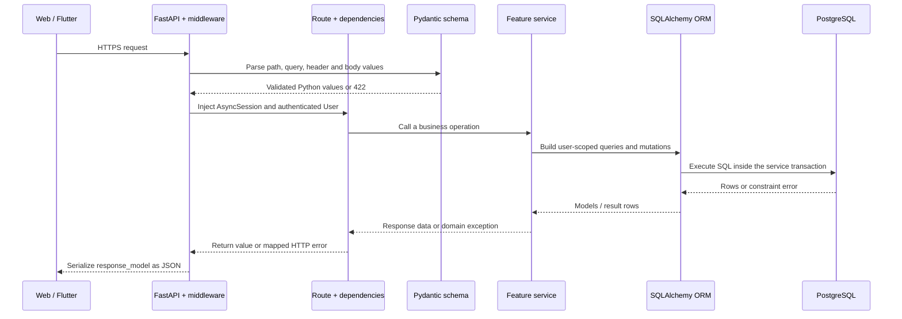

# Backend Design

This document owns backend layering, state transitions and consistency rules.
Endpoint fields and status codes are maintained in the [API reference](../reference/API_REFERENCE.md);
quantity semantics are maintained in [quantity rules](QUANTITY_STATE_DESIGN.md).
System decisions and capacity assumptions are in the [architecture overview](README.md).

## 2.1 HTTP request lifecycle and layer ownership

The layer boundaries are:

| Layer | Owns | Must not own |
| --- | --- | --- |
| `app/main.py` | Application construction, middleware, router registration, global validation handlers and resource cleanup | Feature queries, business calculations or commits |
| `app/api/dependencies.py` | Authentication/authorization dependencies and request-scoped dependency composition | Feature-specific inventory, catalog or administrator rules |
| `app/api/routes/` | HTTP paths and methods, parameter/header extraction, dependency injection, response models/status codes, and domain-error translation | SQL construction, ORM mutation, commits, rollbacks or reusable business rules |
| `app/schemas/` | Pydantic request, query, response and structured error contracts | SQLAlchemy models, sessions or database access |
| `app/services/` | User-scoped reads, ownership/state/version rules, calculations, locking, idempotency, ORM changes, and transaction completion | FastAPI request/response objects, HTTP status codes or routing |
| `app/db/models.py` | SQLAlchemy persistence mapping and database-level relationships/constraints | HTTP validation or endpoint behavior |
| `app/core/` | Configuration, security and reusable pure domain helpers | Route registration or feature transaction orchestration |
| `migrations/` and `scripts/` | Repeatable database structure and explicit initialization/maintenance | Request-time schema changes |

Routes may use `AsyncSession` and ORM `User` types supplied by dependencies, but
they do not execute SQL or alter ORM state. All feature reads, including simple
list/detail queries, go through services. Services raise domain exceptions; route
or application handlers translate only known exceptions into stable HTTP errors.
Unexpected database errors are rolled back by the transaction-owning service and
must not expose SQL, credentials or stack traces to clients.

For example, `POST /api/v1/inventory-items/{item_id}/operations` follows this
concrete path:

1. FastAPI matches `app/api/routes/inventory.py` and validates `item_id`, the
   `Idempotency-Key` header, and the JSON body as `InventoryOperationCreate`.
2. Dependencies provide one request-scoped `AsyncSession` and load the current
   active `User` from the bearer token.
3. The route passes validated values and `user.id` to
   `app/services/inventory.py::submit_inventory_operation`; it does not read or
   write the database itself.
4. The service performs the ownership, state, version and idempotency checks,
   calls the pure quantity helpers, updates `InventoryItem`, inserts an
   `InventoryOperation`, and commits once or rolls back on failure.
5. The service returns `OperationResult`. The route selects HTTP 201 for a new
   operation or 200 for a replay, and FastAPI serializes the declared response
   model into the final JSON response.

Pydantic validation failures occur before the route body runs. Domain failures
travel back from the service to the registered handler, which supplies the HTTP
status and error body. A successful service return and the route's response
metadata are assembled by FastAPI; application code does not manually concatenate
the status, headers and JSON bytes.

More APIs do not necessarily require more tables. Updating data requires no
migration; adding fields requires matching model, table definition, schema and API
updates.

## 6. State and relationship rules

| Inventory source state | Metadata PATCH / move | ADD | CONSUME | RECONCILE | discard | archive |
| --- | --- | --- | --- | --- | --- | --- |
| IN_STOCK | Allowed | Allowed | Allowed with sufficient effective balance | Allowed | Allowed | Allowed |
| EMPTY | Allowed | Allowed in an ACTIVE space; restores IN_STOCK | Rejected | Zero stays EMPTY; positive requires an ACTIVE space and restores IN_STOCK | Rejected | Allowed |
| DISCARDED | Rejected | Rejected | Rejected | Rejected | Rejected | Rejected |
| ARCHIVED | Rejected | Rejected | Rejected | Rejected | Rejected | Rejected |

Spaces are ACTIVE or ARCHIVED only. IN_STOCK inventory prevents space archival; EMPTY inventory does not. An archived space cannot receive newly created or moved stock. Before adding to or reconciling a positive total for its EMPTY inventory, move that inventory or restore the space. Repeated space archive/restore returns current state successfully. Edit space name/type only while ACTIVE. A conflicting active name on restoration returns 409.

Archiving catalog entries does not delete or freeze existing inventory. Creating inventory or establishing/changing definition associations requires ACTIVE definitions and categories. Existing inventory can still be consumed, reconciled, replenished, and moved; catalog deactivation must not block actual stock management. Restoring a definition requires an ACTIVE category. Archiving a category does not cascade definition state changes. Queries for selectable definitions filter both definition and category state. Archived private definitions can only be restored, not ordinarily edited.

Coordinate concurrent deactivation and new associations. Deactivation does not retroactively invalidate existing references. Ordinary users cannot change owner_user_id; spaces cannot change user_id; inventory cannot move across users.

## 7. Transactions, versions, and repeated requests

### 7.1 Transaction ownership

The outer service owns one commit for each write request and rolls back on failure. Routes do not commit again; internal validation and batch helpers do not commit. Authentication reads can already start a transaction on the same AsyncSession. Do not blindly wrap an existing transaction in `session.begin()`; reuse the request session and make transaction ownership explicit at the write entry point.

The session dependency only yields a session; exiting it does not commit business writes. Preserve the registration service's existing commit behavior and apply consistent transaction ownership to new business writes.

### 7.2 Concurrency protection

- First read target relationships without locks to plan the operation. Then lock relevant spaces, categories, definitions, and inventory in a consistent order, sorting UUIDs within each type. After obtaining locks, recheck ownership, relationships, state, and version.
- Space archival, stock creation, moves, and EMPTY restoration must coordinate on the same space row so stock cannot be added after archival passes its check. If the inventory moved after the planning read, do not continue with the old lock set; roll back and require refresh/retry.
- Compare expected_version after locking inventory, then update and increment. A version-conditional UPDATE is also possible, but cannot replace cross-table space-state protection.
- Catalog deactivation and new associations use the same lock order. Do not merely read ACTIVE and then insert without protection.
- Process batches in lock order and return results in input order. Failed transactions must leave no written sub-items.
- Preview holds no locks across requests. Lists/previews describe state at read time; actual writes recheck it.

After locking, fetch current database values instead of reusing ORM values cached during authentication or planning. Space ownership and catalog ownership are immutable. Lock order is space → category → definition → inventory, with IDs sorted within each type; lock only required records. Administrator changes to a single category/definition also respect relevant ordering. If batch relationships changed during the wait, roll back and return RESOURCE_CHANGED instead of acquiring reverse-order locks while already holding some locks.

The implementation favors understandable serialization. Writes in the same space may wait for each other. Refine lock granularity only if performance requires it, with repeated consistency verification.

### 7.3 User-scoped idempotency

1. Header keys contain 1–64 visible ASCII characters, no whitespace, and are case-sensitive.
2. Derive the database key as `current-user-UUID:client-key`, at most 101 characters within the existing 128-character limit. Do not include inventory ID: otherwise reuse across different inventory items would not be detected as a conflict.
3. After identity and target-ownership checks, look up the key. For an existing successful record, compare inventory_item_id, operation_type, and quantity_kind/value/unit. Literal values `2` and `2.0` are different requests; retries preserve the original expression.
4. expected_version is excluded from business-parameter comparison. Successful replay precedes version/terminal-state checks, so a completed request can return its original operation and current inventory even if inventory later changed or was archived. Replay is forbidden if access has since been lost.
5. Only when no record exists, validate new-request state, version, and quantity. Recheck the key after lock waits so a completed equivalent request is not rejected solely because the submitted version is old.
6. Inventory changes and operation insertion share a transaction. The unique constraint is the final safeguard. If the error is confirmed to be that key's uniqueness conflict, roll back fully, then start a read to compare the committed record. Do not treat every IntegrityError as a replay.
7. An existing non-SUCCESS record with the key produces an explicit conflict; do not automatically reapply historical state. The quantity-operation ledger records no failed requests, so a key may be retried before any success.
8. No automatic expiry/deletion period is defined; keys remain with operation records. Any future history cleanup must reconsider the idempotency-retention promise.

Spaces, catalog entries, and users have no version. After validation, update only submitted fields; the last write wins. This does not prevent stale edits overwriting metadata. Inventory versioning does not imply system-wide version protection.

### 7.4 Concurrency and failure verification

Verify quantities, versions, locks, and rollback with isolated PostgreSQL, not only simulated sessions. Concurrent requests use independent sessions and controlled entry into critical steps. Inspect database quantities, versions, and operations, not just HTTP responses.

Only one of two different modifications with the same version may succeed; concurrent identical idempotent requests apply once. Space archival racing against stock creation, moves, or EMPTY restoration must not leave invalid state. Verify whole-transaction rollback for mid-batch failure and failure between quantity update and operation insertion. Deliver these tests with the relevant APIs and rerun them after performance tuning or adding instances.

Storage-space mutations additionally serialize default selection through the
owner row before locking spaces. Inventory writes retain the space/category/definition/
inventory ordering described above.

## Implementation map

| Location | Responsibility |
| --- | --- |
| `backend/app/api/routes/` | HTTP adapters and response models |
| `backend/app/schemas/` | Input/output contracts |
| `backend/app/services/` | Authentication sessions, catalog, inventory, administration and Agent business actions |
| `backend/app/core/` | Settings, JWT/security helpers and pure calculations |
| `backend/app/db/` | ORM and request-scoped database sessions |
| `backend/app/agents/` | Model configuration, graph, tools, memory and persistence |
| `backend/migrations/` | Ordered schema upgrades |
| `backend/scripts/` | Explicit initialization, verification, smoke and E2E entry points |
| `backend/tests/` | Unit, API, database, concurrency and recovery checks |

Inventory `notes` is nullable text. Session and receipt tables are part of the
current migration history. See [database design](DATABASE_DESIGN.md) for the
complete table structure and [delivery](../delivery/README.md) for existing-database upgrades.

Registration creates ordinary accounts. Protected dependencies verify identity,
active account state and session state; administrator dependencies additionally
check the role. JWT signature and claims are decoded once and passed as trusted
identity to session validation. No feature service accepts a user ID from model
output as authentication. The [security guide](../security/README.md) records
controls and their test evidence.
