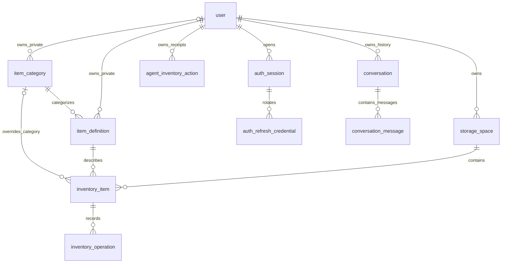

# Database Design

This document owns the current persistence structure. Field contracts are maintained
in the [API reference](../reference/API_REFERENCE.md); quantity semantics are in
[quantity rules](QUANTITY_STATE_DESIGN.md). The [delivery runbook](../delivery/README.md)
owns migration, seed, reset and restore commands.

## Structure and ownership

The SQLAlchemy business metadata defines 11 tables. Inventory ownership follows
inventory_item → storage_space → user. Public categories are shared;
item_category.owner_user_id NULL denotes a public category, otherwise it belongs
to one user. Inventory category reads prefer a batch override over its definition.
item_definition.owner_user_id NULL denotes a public definition, otherwise it
belongs to one user. Foreign keys protect relationships; services also enforce
ownership and active-state rules.

## Table reference

The following field/constraint reference matches `backend/app/db/models.py`.
Defaults generated in Python and database defaults remain defined by that model
and the migrations. UUIDs are generated in Python; timestamps are timezone-aware.

### `item_category`

The 25 seeded public categories and optional user-owned categories. Typed names
reuse a visible category after Unicode NFKC, case-folding and whitespace normalization.
Selectors sort by normalized name and UUID rather than `sort_order`.
Reuse of a category does not combine inventory batches.

| Column | PostgreSQL type | Nullable |
| --- | --- | --- |
| `id` | `UUID` | No |
| `name` | `VARCHAR(100)` | No |
| `normalized_name` | `VARCHAR(100)` | No |
| `owner_user_id` | `UUID` | Yes |
| `status` | `VARCHAR(16)` | No |
| `sort_order` | `INTEGER` | No |
| `created_at` | `TIMESTAMP WITH TIME ZONE` | No |
| `updated_at` | `TIMESTAMP WITH TIME ZONE` | No |

Constraints and indexes:

- `ck_item_category_sort_order_nonnegative`: sort_order >= 0.
- `ck_item_category_status_allowed`: status IN ('ACTIVE', 'ARCHIVED').
- `pk_item_category`: PrimaryKeyConstraint: id.
- `owner_user_id` references user.id with RESTRICT deletion; NULL denotes public ownership.
- `uq_item_category_public_name`: unique normalized_name where owner_user_id IS NULL.
- `uq_item_category_private_owner_name`: unique (owner_user_id, normalized_name) where owner_user_id IS NOT NULL.
- `ix_item_category_status_sort`: item_category.status, item_category.sort_order.

### `user`

Accounts, Argon2 password hashes, role/status and reserved voice counters.

| Column | PostgreSQL type | Nullable |
| --- | --- | --- |
| `id` | `UUID` | No |
| `email` | `VARCHAR(320)` | No |
| `password_hash` | `VARCHAR(255)` | Yes |
| `auth_provider` | `VARCHAR(32)` | No |
| `role` | `VARCHAR(16)` | No |
| `status` | `VARCHAR(16)` | No |
| `voice_limit_seconds` | `INTEGER` | No |
| `voice_used_seconds` | `INTEGER` | No |
| `voice_quota_reset_at` | `TIMESTAMP WITH TIME ZONE` | Yes |
| `created_at` | `TIMESTAMP WITH TIME ZONE` | No |
| `updated_at` | `TIMESTAMP WITH TIME ZONE` | No |

Constraints and indexes:

- `ck_user_role_allowed`: role IN ('USER', 'ADMIN').
- `ck_user_status_allowed`: status IN ('ACTIVE', 'SUSPENDED', 'DISABLED').
- `ck_user_voice_limit_nonnegative`: voice_limit_seconds >= 0.
- `ck_user_voice_used_nonnegative`: voice_used_seconds >= 0.
- `pk_user`: PrimaryKeyConstraint: id.
- `uq_user_email`: UniqueConstraint: email.

`voice_limit_seconds`, `voice_used_seconds` and `voice_quota_reset_at` are unused.
New accounts default to zero limit/usage and a NULL reset time. The application
does not meter speech duration or enforce a cumulative per-user quota through
these fields. They are reserved for voice-service metering and quota management;
see the [voice policy](../product/README.md#voice-replies-and-usage-quotas).

### `agent_inventory_action`

Committed per-item Agent receipts, result snapshots and calculation evidence.

| Column | PostgreSQL type | Nullable |
| --- | --- | --- |
| `id` | `UUID` | No |
| `user_id` | `UUID` | No |
| `conversation_id` | `UUID` | No |
| `turn_id` | `UUID` | No |
| `action` | `VARCHAR(24)` | No |
| `request_fingerprint` | `VARCHAR(64)` | No |
| `request_snapshot` | `JSONB` | No |
| `result_snapshot` | `JSONB` | No |
| `created_at` | `TIMESTAMP WITH TIME ZONE` | No |

Constraints and indexes:

- `fk_agent_inventory_action_user_id_user`: user_id → user.id.
- `pk_agent_inventory_action`: PrimaryKeyConstraint: id.
- `ix_agent_inventory_action_user_id`: agent_inventory_action.user_id.

### `auth_session`

Per-device session deadlines, revocation and current refresh state.

| Column | PostgreSQL type | Nullable |
| --- | --- | --- |
| `id` | `UUID` | No |
| `user_id` | `UUID` | No |
| `expires_at` | `TIMESTAMP WITH TIME ZONE` | No |
| `absolute_expires_at` | `TIMESTAMP WITH TIME ZONE` | No |
| `revoked_at` | `TIMESTAMP WITH TIME ZONE` | Yes |
| `created_at` | `TIMESTAMP WITH TIME ZONE` | No |

Constraints and indexes:

- `fk_auth_session_user_id_user`: user_id → user.id.
- `pk_auth_session`: PrimaryKeyConstraint: id.
- `ix_auth_session_user_id`: auth_session.user_id.

### `conversation`

Conversation ownership and public chat history. LangGraph checkpoints retain
Agent workflow and recovery state.

| Column | PostgreSQL type | Nullable |
| --- | --- | --- |
| `id` | `UUID` | No |
| `user_id` | `UUID` | No |
| `title` | `VARCHAR(200)` | Yes |
| `is_primary` | `BOOLEAN` | No |
| `history_complete` | `BOOLEAN` | No |
| `created_at` | `TIMESTAMP WITH TIME ZONE` | No |
| `updated_at` | `TIMESTAMP WITH TIME ZONE` | No |

Constraints and indexes:

- `fk_conversation_user_id_user`: user_id → user.id.
- `pk_conversation`: PrimaryKeyConstraint: id.
- `ix_conversation_user_updated_desc`: conversation.user_id, updated_at DESC.
- `uq_conversation_primary_user`: unique user_id where is_primary is true.

`title` is reserved for persisted title management. Clients currently derive
history-list titles from the first user message; no title-generation or rename
workflow writes this field. `is_primary` identifies the user's main chat;
`history_complete` records public-history coverage. See
[conversation title management](../product/README.md#conversation-title-management).

### `item_definition`

Public/private product definitions, not stock quantities.

| Column | PostgreSQL type | Nullable |
| --- | --- | --- |
| `id` | `UUID` | No |
| `name` | `VARCHAR(100)` | No |
| `normalized_name` | `VARCHAR(100)` | No |
| `category_id` | `UUID` | No |
| `owner_user_id` | `UUID` | Yes |
| `status` | `VARCHAR(16)` | No |
| `created_at` | `TIMESTAMP WITH TIME ZONE` | No |
| `updated_at` | `TIMESTAMP WITH TIME ZONE` | No |

Constraints and indexes:

- `ck_item_definition_status_allowed`: status IN ('ACTIVE', 'ARCHIVED').
- `fk_item_definition_category_id_item_category`: category_id → item_category.id.
- `fk_item_definition_owner_user_id_user`: owner_user_id → user.id.
- `pk_item_definition`: PrimaryKeyConstraint: id.
- `ix_item_definition_category_status`: item_definition.category_id, item_definition.status.
- `ix_item_definition_owner_status`: item_definition.owner_user_id, item_definition.status.
- `uq_item_definition_private_owner_name`: unique item_definition.owner_user_id, item_definition.normalized_name; predicate owner_user_id IS NOT NULL.
- `uq_item_definition_public_name`: unique item_definition.normalized_name; predicate owner_user_id IS NULL.

### `storage_space`

User-owned spaces, active/archived status and default-space flag.

| Column | PostgreSQL type | Nullable |
| --- | --- | --- |
| `id` | `UUID` | No |
| `user_id` | `UUID` | No |
| `name` | `VARCHAR(100)` | No |
| `is_default` | `BOOLEAN` | No |
| `type` | `VARCHAR(16)` | No |
| `status` | `VARCHAR(16)` | No |
| `created_at` | `TIMESTAMP WITH TIME ZONE` | No |
| `updated_at` | `TIMESTAMP WITH TIME ZONE` | No |

Constraints and indexes:

- `ck_storage_space_default_space_active`: NOT is_default OR status = 'ACTIVE'.
- `ck_storage_space_status_allowed`: status IN ('ACTIVE', 'ARCHIVED').
- `ck_storage_space_type_allowed`: type IN ('FRIDGE', 'FREEZER', 'PANTRY', 'WAREHOUSE', 'OTHER').
- `fk_storage_space_user_id_user`: user_id → user.id.
- `pk_storage_space`: PrimaryKeyConstraint: id.
- `ix_storage_space_user_status`: storage_space.user_id, storage_space.status.
- `uq_storage_space_active_user_name`: unique storage_space.user_id, lower(name); predicate status = 'ACTIVE'.
- `uq_storage_space_user_default`: unique storage_space.user_id; predicate is_default.

### `auth_refresh_credential`

SHA-256 refresh hashes, consumption/rotation and session association.

| Column | PostgreSQL type | Nullable |
| --- | --- | --- |
| `token_hash` | `VARCHAR(64)` | No |
| `session_id` | `UUID` | No |
| `used_at` | `TIMESTAMP WITH TIME ZONE` | Yes |

Constraints and indexes:

- `fk_auth_refresh_credential_session_id_auth_session`: session_id → auth_session.id.
- `pk_auth_refresh_credential`: PrimaryKeyConstraint: token_hash.
- `ix_auth_refresh_credential_session_id`: auth_refresh_credential.session_id.

### `conversation_message`

Saved public USER/ASSISTANT text messages for conversation history. Images are
represented by attachment text; Agent checkpoints retain workflow messages and
recovery state.

| Column | PostgreSQL type | Nullable |
| --- | --- | --- |
| `id` | `UUID` | No |
| `conversation_id` | `UUID` | No |
| `role` | `VARCHAR(16)` | No |
| `content` | `TEXT` | No |
| `created_at` | `TIMESTAMP WITH TIME ZONE` | No |

Constraints and indexes:

- `ck_conversation_message_role_allowed`: role IN ('USER', 'ASSISTANT').
- `fk_conversation_message_conversation_id_conversation`: conversation_id → conversation.id.
- `pk_conversation_message`: PrimaryKeyConstraint: id.
- `ix_conversation_message_order`: conversation_message.conversation_id, conversation_message.created_at, conversation_message.id.

### `inventory_item`

One stock batch, initial/confirmed/estimated quantities, dates, nullable notes and version.
Multiple batches can share a definition, category and space while retaining separate
IDs, quantities and expiry dates. Creation does not deduplicate stock batches.

`category_override_id` is nullable. Inventory reads and category/expiry filters use
`COALESCE(inventory_item.category_override_id, item_definition.category_id)`.
An inventory-details category edit sets an override for that batch without changing
the definition or sibling batches.

| Column | PostgreSQL type | Nullable |
| --- | --- | --- |
| `id` | `UUID` | No |
| `storage_space_id` | `UUID` | No |
| `item_definition_id` | `UUID` | No |
| `notes` | `TEXT` | Yes |
| `category_override_id` | `UUID` | Yes |
| `purchase_date` | `DATE` | Yes |
| `expiry_date` | `DATE` | Yes |
| `status` | `VARCHAR(16)` | No |
| `initial_amount` | `NUMERIC(12, 3)` | No |
| `initial_unit` | `VARCHAR(16)` | No |
| `confirmed_current_amount` | `NUMERIC(12, 3)` | No |
| `confirmed_current_unit` | `VARCHAR(16)` | No |
| `confirmed_at` | `TIMESTAMP WITH TIME ZONE` | No |
| `estimated_current_amount` | `NUMERIC(12, 3)` | Yes |
| `estimated_current_unit` | `VARCHAR(16)` | Yes |
| `estimated_at` | `TIMESTAMP WITH TIME ZONE` | Yes |
| `version` | `INTEGER` | No |
| `created_at` | `TIMESTAMP WITH TIME ZONE` | No |
| `updated_at` | `TIMESTAMP WITH TIME ZONE` | No |

Constraints and indexes:

- `ck_inventory_item_estimate_trio`: (estimated_current_amount IS NULL AND estimated_current_unit IS NULL AND estimated_at IS NULL) OR (estimated_current_amount IS NOT NULL AND estimated_current_unit IS NOT NULL AND estimated_at IS NOT NULL).
- `ck_inventory_item_nonnegative_amounts`: initial_amount >= 0 AND confirmed_current_amount >= 0 AND (estimated_current_amount IS NULL OR estimated_current_amount >= 0).
- `ck_inventory_item_status_allowed`: status IN ('IN_STOCK', 'EMPTY', 'DISCARDED', 'ARCHIVED').
- `ck_inventory_item_version_positive`: version >= 1.
- `category_override_id` references item_category.id with RESTRICT deletion.
- `fk_inventory_item_item_definition_id_item_definition`: item_definition_id → item_definition.id.
- `fk_inventory_item_storage_space_id_storage_space`: storage_space_id → storage_space.id.
- `pk_inventory_item`: PrimaryKeyConstraint: id.
- `ix_inventory_item_definition`: inventory_item.item_definition_id.
- `ix_inventory_item_storage_status`: inventory_item.storage_space_id, inventory_item.status.
- `ix_inventory_item_storage_status_expiry`: inventory_item.storage_space_id, inventory_item.status, inventory_item.expiry_date.

### `inventory_operation`

Successful ADD/CONSUME/RECONCILE history, input/calculation basis and idempotency key.

| Column | PostgreSQL type | Nullable |
| --- | --- | --- |
| `id` | `UUID` | No |
| `inventory_item_id` | `UUID` | No |
| `operation_type` | `VARCHAR(24)` | No |
| `affects_state` | `VARCHAR(24)` | No |
| `input_method` | `VARCHAR(16)` | No |
| `quantity_kind` | `VARCHAR(24)` | No |
| `quantity_value` | `VARCHAR(32)` | No |
| `quantity_unit` | `VARCHAR(16)` | Yes |
| `calculation_method` | `VARCHAR(24)` | No |
| `applied_change_amount` | `NUMERIC(12, 3)` | Yes |
| `applied_change_unit` | `VARCHAR(16)` | Yes |
| `status` | `VARCHAR(24)` | No |
| `idempotency_key` | `VARCHAR(128)` | No |
| `created_at` | `TIMESTAMP WITH TIME ZONE` | No |
| `updated_at` | `TIMESTAMP WITH TIME ZONE` | No |
| `undone_at` | `TIMESTAMP WITH TIME ZONE` | Yes |

Constraints and indexes:

- `ck_inventory_operation_affects_state_allowed`: affects_state IN ('CONFIRMED', 'ESTIMATED').
- `ck_inventory_operation_applied_change_nonnegative`: applied_change_amount IS NULL OR applied_change_amount >= 0.
- `ck_inventory_operation_applied_change_pair`: (applied_change_amount IS NULL AND applied_change_unit IS NULL) OR (applied_change_amount IS NOT NULL AND applied_change_unit IS NOT NULL).
- `ck_inventory_operation_calculation_method_allowed`: calculation_method IN ('EXACT', 'CONVERTED', 'AI_ESTIMATED').
- `ck_inventory_operation_input_method_allowed`: input_method IN ('TEXT', 'VOICE', 'PHOTO', 'RECEIPT', 'MANUAL').
- `ck_inventory_operation_operation_type_allowed`: operation_type IN ('ADD', 'CONSUME', 'RECONCILE').
- `ck_inventory_operation_quantity_kind_allowed`: quantity_kind IN ('AMOUNT', 'FRACTION', 'QUALITATIVE').
- `ck_inventory_operation_status_allowed`: status IN ('PENDING_CONFIRMATION', 'SUCCESS', 'FAILED', 'UNDONE').
- `ck_inventory_operation_undone_timestamp_matches_status`: (status = 'UNDONE' AND undone_at IS NOT NULL) OR (status <> 'UNDONE' AND undone_at IS NULL).
- `fk_inventory_operation_inventory_item_id_inventory_item`: inventory_item_id → inventory_item.id.
- `pk_inventory_operation`: PrimaryKeyConstraint: id.
- `uq_inventory_operation_idempotency_key`: UniqueConstraint: idempotency_key.
- `ix_inventory_operation_item_created`: inventory_operation.inventory_item_id, inventory_operation.created_at.
- `ix_inventory_operation_item_status`: inventory_operation.inventory_item_id, inventory_operation.status.

`UNDONE` and `undone_at` are reserved for an undo workflow. The current write API
creates SUCCESS quantity operations and provides no undo endpoint. History reads
can represent stored UNDONE records. Quantity correction creates a new RECONCILE
record and preserves earlier operations; see
[correction and undo](QUANTITY_STATE_DESIGN.md#correction-and-undo).

## Agent persistence and consistency

LangGraph checkpoint/store tables use a separate configured Agent schema on the
same PostgreSQL service by default. They are initialized explicitly, not by API
startup. Checkpoints retain messages/images and pending tasks; the Store retains
user-scoped memory. Business receipts are separate from checkpoint progress.
Their conversation identifier is a logical reference rather than a foreign key
to the conversation history table.

Quantity-operation idempotency is user-scoped in the stored key. Constraints,
ordered row locks, version checks and transaction ownership jointly protect stock;
see [backend consistency](BACKEND_DESIGN.md). Default-space selection is protected
by its active/default constraint and partial unique index. Refresh-session hashes
support rotation and revocation without storing plaintext credentials.

## Categories and initialization

Required category seed is repeatable. Definitions and demo accounts are separate
from categories: a category groups products, a definition names a product, and an
inventory item records its physical batch. Optional demo seed and target guards
are described in [delivery](../delivery/README.md#optional-demo-data).

### Category boundaries

Category guidance is maintained in `backend/app/core/category_catalog.py`.
Categories describe product identity rather than packaging or storage location.

| Category | Includes / examples | Excludes / boundary |
| --- | --- | --- |
| Vegetables & Mushrooms | Vegetables, mushrooms and plain preserved vegetables. Examples: carrot, canned tomatoes, frozen peas. | Exclude tomato sauce, prepared meals and dried legumes. |
| Fruit | Whole, cut, dried or plain preserved fruit. Examples: apple, frozen berries, raisins. | Exclude juice, jam and fruit desserts. |
| Fresh Herbs | Fresh culinary herbs. Examples: coriander, fresh basil. | Dried herbs belong to Dried Herbs & Spices. |
| Meat & Poultry | Raw meat and poultry, including frozen or marinated cuts. Examples: chicken breast, beef steak. | Exclude sausages, cured meats and prepared meals. |
| Fish & Seafood | Fish and seafood, including plain canned, smoked or frozen products. Examples: salmon, canned tuna, prawns. | Exclude complete prepared meals and seafood sauces. |
| Eggs | Shell eggs and liquid egg products. Examples: chicken eggs, egg whites. | Exclude egg dishes and mayonnaise. |
| Processed & Deli Meats | Processed, cured and deli meat products. Examples: ham, bacon, sausages. | Exclude raw meat cuts, seafood and complete meals. |
| Milk & Plant-Based Milk | Dairy milk and plant-based drinks intended as milk substitutes. Examples: Anchor milk, oat milk, drinking coconut milk. | Cooking coconut milk belongs to Sauces, Condiments & Spreads; ask intended use if unclear. |
| Yoghurt | Dairy and plant-based yoghurt. Examples: Greek yoghurt, coconut yoghurt. | Exclude milk drinks, ice cream and frozen yoghurt. |
| Cheese | Dairy and plant-based cheese. Examples: cheddar, vegan cheese. | Exclude butter, cream and cheese sauces. |
| Butter & Cream | Butter, margarine and dairy or plant-based cream. Examples: butter, whipping cream, margarine. | Exclude cooking oils and cooking coconut milk. |
| Tofu & Meat Alternatives | Tofu, tempeh and plant-based meat substitutes. Examples: tofu, vegan mince. | Exclude plant milk, cheese, dried legumes and complete meals. |
| Rice, Pasta & Grains | Unprepared rice, noodles, pasta, grains and breakfast cereals. Examples: rice, spaghetti, oats. | Exclude bread, flour, filled dumplings and complete meals. |
| Bread & Bakery | Baked bread, wraps, buns and pastries. Examples: toast bread, croissant, tortilla. | Exclude baking ingredients, biscuits and packaged cakes or desserts. |
| Dried Legumes, Nuts & Seeds | Dried pulses, plain preserved beans, nuts and edible seeds. Examples: lentils, canned chickpeas, almonds. | Exclude fresh green beans, tofu, nut spreads and confectionery-coated nuts. |
| Baking Ingredients | Ingredients primarily used for baking. Examples: flour, sugar, yeast, baking cocoa. | Eggs, milk, butter and oils retain their own categories. |
| Sauces, Condiments & Spreads | Sauces, stocks, condiments, jams and spreads; coconut milk for cooking. Examples: Lao Gan Ma, tomato sauce, peanut butter, cooking coconut milk. | Exclude plain vegetables, oils, vinegar and dry spice powders. |
| Oils & Vinegars | Edible oils and culinary vinegars. Examples: olive oil, rice vinegar. | Exclude butter and prepared salad dressings. |
| Dried Herbs & Spices | Dried herbs, spices, salt and dry seasoning blends. Examples: cumin, dried basil, salt. | Exclude fresh herbs, sugar and liquid sauces. |
| Prepared Meals & Leftovers | Prepared dishes, soups, meal kits and leftovers; includes filled dumplings and pizza. Examples: frozen pizza, leftover curry, dumplings. | Plain single ingredients retain their own category regardless of storage. |
| Snacks & Desserts | Snack foods, confectionery and non-frozen desserts. Examples: chips, biscuits, chocolate, cake. | Exclude plain nuts, fruit, yoghurt, pastries and frozen desserts. |
| Ice Cream & Frozen Desserts | Ice cream, frozen yoghurt, sorbet and ice pops. Examples: ice cream, sorbet. | Other frozen foods retain their product category. |
| Drinks, Tea & Coffee | Water, juice, soft drinks, alcohol, tea and coffee. Examples: coffee, orange juice, beer. | Milk and plant-based milk drinks retain their own category. |
| Household Supplies | Non-food household consumables. Examples: dish soap, paper towels, shampoo. | Do not classify human food here; ask about unrecognized products. |
| Other | No suitable catalog category after clarification; requires user confirmation. Examples: an identified product outside the listed categories. | Never silently use Other for unreadable names or uncertain product identity. |

### Classification behavior

Search existing definitions first and reuse their category. For new definitions, retrieve
real active category IDs and guidance. Ask about unknown products or ambiguous use; never
invent IDs, categories or certainty from a brand/receipt abbreviation. Other is a confirmed
fallback for an identified out-of-catalog item, not an automatic label for unreadable input.
New-definition previews display the item and category and retain the existing confirmation
and correction workflow. A definition supplies the fallback category. Direct definition
edits and approved Agent definition corrections affect related batches without overrides.
Inventory-details edits instead set a category override for only the selected batch.
Batches with overrides retain those effective categories after a definition correction.

Product identity and storage are separate: frozen chicken remains meat; canned tomatoes
remain vegetables; tomato sauce is a condiment; frozen pizza is a prepared meal. Drinking
coconut milk is plant milk, cooking coconut milk is a cooking ingredient under sauces.

### Classification references

The 25 categories were selected for household inventory entry and filtering.
The following sources inform category boundaries and retail vocabulary.

- [FAO/WHO GIFT food groups](https://www.fao.org/gift-individual-food-consumption/methodology/food-groups-and-sub-groups): groupings differ by analytic purpose.
- [EFSA FoodEx2](https://www.efsa.europa.eu/en/data/data-standardisation): food classification and descriptive properties.
- [GS1 GPC](https://www.gs1.org/standards/gpc/get-started): common product group definitions.
- [New World fridge categories](https://www.newworld.co.nz/shop/category/fridge-deli-and-eggs) and [pantry categories](https://www.newworld.co.nz/shop/category/pantry): local retail vocabulary.

## Category migration

Migration `a261002_categories` follows `a261001_sessions`. It adds the nullable
category owner and inventory category override foreign keys, and replaces the
global category-name uniqueness constraint with separate public/private indexes.
Existing category IDs, inventory IDs, quantities and dates are retained. Existing
categories remain public and existing batches start without overrides. Apply the migration to the intended deployment database, then verify its revision
and schema using the
[delivery runbook](../delivery/README.md#database-initialization-and-migration).

The downgrade refuses to run while private categories or batch overrides exist;
export and resolve that data explicitly before attempting a downgrade.

## Verification evidence

`verify_database_schema.py` compares database objects with the ORM read-only;
`record_database_acceptance.py` records a selected environment's revision, category
seed and structural checks. Empty-database initialization, ownership, constraints,
rollback and concurrent writes are tested in isolated PostgreSQL schemas.
See [database acceptance](../testing/reports/DATABASE_ACCEPTANCE.md) and the
[testing guide](../testing/README.md). Recorded environment results identify a run;
the schema reference above describes the current source definition.
