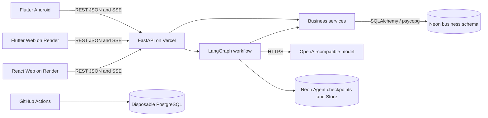

# System Architecture

SayFridge combines Flutter Android, Flutter Web and React Web with one FastAPI
backend and a shared PostgreSQL database. The clients use authenticated HTTPS;
they never receive database credentials or the model API key.

## Design decisions

| Decision | Reason and tradeoff |
| --- | --- |
| Separate Mobile and Web clients | Mobile supports camera, speech input and quick recording; Web supports large-screen review, batch work and administration. Both share accounts and business data. |
| One modular backend | Routers, schemas, services and ORM separate HTTP, validation, business rules and persistence without the deployment overhead of microservices. |
| REST and JSON for business resources | HTTP methods, status codes and OpenAPI give both clients an explicit inventory contract. |
| POST with SSE for Agent replies | Streaming delivers text, proposals and results incrementally. Fetch-based readers support request bodies and bearer authorization; browser EventSource is GET-based. Human confirmation ends one stream and starts a later request. WebSockets would add connection/session management without a current bidirectional streaming requirement. |
| PostgreSQL and Alembic | Relationships, constraints, transactions and migrations protect stock consistency. Database-backed sessions and receipts work across backend instances. |
| Own authentication service | Argon2, signed access JWTs and rotating refresh sessions integrate with existing PostgreSQL account roles and ownership. Firebase Auth and Firestore are not used. |
| LangGraph persistence | Checkpoints retain pending tasks and resume state; a user-scoped Store retains explicit preferences. Business receipts independently establish whether an inventory write committed. |
| Pooled and direct database connections | Runtime business queries use the pooled URL. Migrations, Agent persistence and conversation advisory locks use direct connections. |
| Render plus Vercel plus Neon | Static clients are built separately from the Python service. Environment configuration supplies API origins, CORS and secrets. Deployment instructions belong to the delivery guide. |

### Voice interaction and usage policy

Mobile uses device/browser speech recognition to produce editable text. The
Backend processes that text and returns text replies. The team selected this
flow to focus on inventory reliability and control integration effort, latency
and operating costs within the development schedule. Spoken replies and Backend
speech processing are not implemented.

The prototype has no cumulative per-user usage quota. The team deferred quota
design until usage and cost data are available. The database voice counters are unused;
authentication and request limits remain active. Current behavior and deferred
work are recorded in the [product scope](../product/README.md#deferred-non-core-features).

## Request and data boundaries

[Backend design](BACKEND_DESIGN.md) describes the HTTP lifecycle, transaction
ownership, locks, versions and idempotency. [Database design](DATABASE_DESIGN.md)
maintains table definitions and relationships. [Quantity rules](QUANTITY_STATE_DESIGN.md)
maintain exact and estimated balance semantics. [Agent design](AGENT_DESIGN.md)
maintains the graph, memory, confirmation and recovery rules.

## Capacity assumptions and scaling

The following **initial engineering assumptions** define the performance baseline. The [performance record](../testing/records/PERFORMANCE_TEST_RECORD.md) records the measured results. Update load assumptions and acceptance targets when requirements change.

| Topic | Initial assumption and purpose |
| --- | --- |
| Users | 100 registered users, 10 concurrently active users |
| Normal traffic | Aggregate 5 requests/second, approximately 80% reads and 20% writes; test authentication separately |
| Data volume | 50,000 inventory batches and 500,000 quantity operations across several users, including a user with extensive history |
| Hotspots | Test independent spaces, different inventory items in the same space, and concurrent writes to the same item separately |
| Initial performance target | After warm-up, sustain normal load for 10 minutes; read p95 ≤ 500 ms, ordinary single-item write p95 ≤ 1,000 ms, unexpected error rate < 1% |

p95 means 95% of requests complete within that duration. The table defines performance acceptance targets; the performance record contains measured results. Reports must identify application/database specifications and regions, client location, data volume, connection pools, versions, and commands. Report cold starts, login password hashing, and batch operations separately. Record deliberately induced version/state conflicts separately from normal-load errors.

Measure API latency, errors, database connections, query time, and lock waits before optimizing. For slow queries, inspect execution plans, indexes, and pagination. For connection pressure, adjust per-instance limits so instance count times connection budget stays within database capacity. Consider more application instances when application CPU saturates. Current per-space serialization prioritizes correctness; if it becomes a bottleneck, review lock granularity and rerun consistency tests.

Do not add caches or change indexes preemptively. If measurements justify schema changes, update the ORM, migration and database design, and record the measured reason.

## Verification and operation

- [Testing strategy and evidence](../testing/README.md): isolated CI, real-browser E2E and recorded reports.
- [Security and privacy](../security/README.md): implemented controls, findings and verification.
- [Build and deployment](../delivery/README.md): main commit selection, database upgrade, hosting and APK delivery.
- [Historical Realtime design](../archive/2026-09-25/ARCHITECTURE_REALTIME_DRAFT.md): earlier alternatives, not the current architecture.

Original blueprints, design alternatives and pre-consolidation records remain
available through the [project archive](../archive/README.md).
