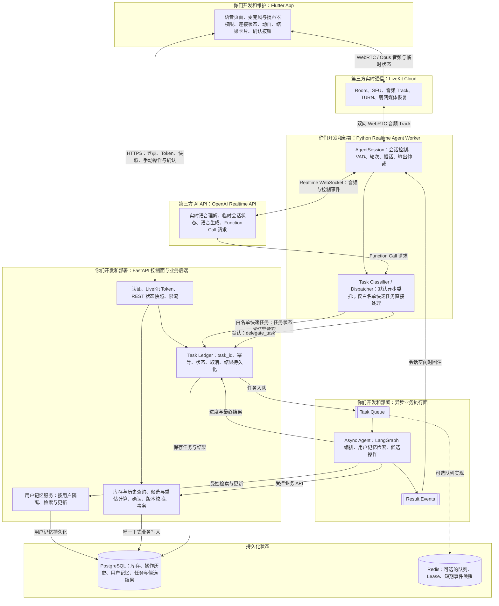

> 已归档 / Archived — 2026-09-25。以下内容保留历史决策和当时状态，不是当前实施指令。当前入口：[当前架构](../../architecture/AGENT_DESIGN.md)、[接口参考](../../reference/API_REFERENCE.md)与[启动说明](../../../backend/README.md)。旧文中的阶段限制、能力和部署说明仅代表当时方案。

# SayFridge Realtime + Async 双 Agent 完整架构

> 状态：目标架构草案。该图描述计划实现的组件边界，不代表当前已经完成部署。
>
> 核心原则：**Async Agent 是主要业务执行者；Realtime Agent 是语音交互与任务调度入口。Agent 业务任务默认异步委托；手动操作直接调用 FastAPI。只有经过明确分类的低风险、低延迟、简单任务，才允许 Realtime Agent 直接处理。**

## 完整架构图



## 关键执行链

### 1. 实时语音与白名单 Fast Path

```text
Flutter 麦克风
→ WebRTC / Opus
→ LiveKit Cloud
→ Python Realtime Agent Worker
→ OpenAI Realtime WebSocket
→ 普通对话直接返回，业务请求进入任务分类
→ 仅命中白名单的低风险、低延迟、简单任务直接处理
→ AI 音频原路返回 Flutter
```

Realtime Agent 的核心目标是保持自然语音交互和及时反馈，而不是承担主要业务执行。它不能因为任务“看起来简单”就自行直办；只有显式白名单允许的任务才能进入 Fast Path，其余任务一律异步委托。

### 2. 默认业务执行路径

```text
OpenAI 产生 Function Call 请求
→ Python Realtime Worker 进行任务分类
→ 未命中直接处理白名单（默认情况）
→ FastAPI Task Ledger 创建 task_id
→ Task Queue
→ Async Agent 执行库存查询、候选操作、RAG 或多步骤工具编排
→ FastAPI 保存进度和结果
→ Result Event 通知 Realtime Worker
→ 会话空闲时播报；否则由 Flutter 结果卡片展示
```

异步委托是 Agent 业务任务的默认路径，不只是耗时任务的兜底路径。OpenAI Realtime API 不直接调用 Async Agent；Python Realtime Worker 负责创建受控任务，Async Agent 再通过 FastAPI 业务接口执行操作。

### 3. Agent 库存修改路径

```text
用户语音
→ Realtime Agent 创建异步任务
→ Async Agent 生成候选操作
→ FastAPI 校验并保存 proposed action
→ Flutter 获取并展示确认卡片
→ 用户点击确认
→ Flutter 通过 HTTPS 提交 action_id
→ FastAPI 重新鉴权并校验参数、单位、库存版本和幂等键
→ PostgreSQL 事务写入与审计
```

用户插话只中断当前 AI 音频，不自动确认、撤销或取消后台任务。

### 4. 手动库存操作路径

~~~text
Flutter / Web 用户点击增加、减少或确认剩余
→ 弹窗填写数量与单位，展示候选结果
→ 用户确认
→ HTTPS 调用 FastAPI
→ 后端校验身份、单位、库存版本与幂等键，按当前状态计算
→ 同一 PostgreSQL 事务更新库存与操作历史
→ 返回最新库存
~~~

手动操作无需经过 Agent，与 Agent 操作共用后端业务规则和操作历史。预览不写库存，后端不信任客户端传来的最终余额；版本变化时返回冲突，重新展示结果供用户确认。确定性加减与单位换算由后端执行，遇到不确定换算可进入 Agent 候选流程。

### 5. 用户记忆与历史重估路径

~~~text
用户补充换算信息
→ Async Agent 识别适用物品、条件与时间范围，必要时追问
→ 经受控服务保存该用户的记忆及来源
→ 用户信息适用于历史时，读取相关库存与有效操作历史
→ FastAPI 从最近确认剩余的基线（或首次入库）计算重估候选
→ 保存候选余额、依据、适用范围与库存版本
→ Flutter / Web 展示原余额、新估算余额及修正依据
→ 用户确认
→ FastAPI 重新校验与计算，事务更新估算余额并新增更正记录
~~~

Agent 负责理解新信息、检索相关记忆与确定候选适用范围；后端负责确定的算术和状态变化。记忆更新不等于库存变更，拒绝库存候选也不会自动撤销用户已明确提供的换算说明。无法确定适用范围时先追问。

重算保留原始历史，不跨越最近一次盘点去改变新的确认事实。候选产生后库存版本变化，需要重新生成结果并再次确认。详细规则见 [QUANTITY_STATE_DESIGN.md](../../architecture/QUANTITY_STATE_DESIGN.md)。

## 用户级记忆、业务历史与 LangGraph

每个用户维护统一的 Agent 记忆，不按 item 建立独立记忆，也不为每个物品常驻运行 Agent。同一套 LangGraph 流程按当前认证用户读取相关记忆、本次库存状态及必要历史。记忆内容可限定物品、量具、时间等适用条件，并在条件一致时跨库存批次复用。

| 内容 | 负责组件与存储 | 用途 |
| --- | --- | --- |
| 当前库存与正式操作历史 | FastAPI + PostgreSQL | 当前余额、审计、历史重估；手动和 Agent 共用 |
| 用户长期记忆 | 受控用户记忆服务 + PostgreSQL | 用户习惯、换算说明、适用范围及来源 |
| Agent 执行状态 | LangGraph checkpoint，持久化后端计划使用 PostgreSQL | 任务恢复、步骤状态与等待确认 |
| 任务及候选结果 | FastAPI Task Ledger 与候选管理 | 客户端查询、确认、幂等及结果持久化 |
| 应用日志 | 日志设施 | 错误与耗时排查，不作为库存事实来源 |

检查点不能替代正式操作历史，也不能代替后端确认接口的权限和事务校验。用户记忆、检查点与业务记录的具体表结构及接入方式留待实施设计，本轮不修改数据库设计基线，不宣称这些能力已完成。

库存列表读取当前状态，历史按物品分页查询；Agent 按需加载相关用户记忆与有限历史，历史重估才读取对应区间。数据库按实际查询建立索引，不为每个用户或物品单独建表，不在每次任务中加载全部历史。

## 任务路由规则

以下规则适用于 Realtime Agent 收到的请求；用户手动操作走上述 FastAPI 路径。采用 **deny-by-default（默认不直办）** 的任务分类方式。一个任务只有同时满足“低风险、低延迟、逻辑简单、已进入显式白名单”四个条件，Realtime Agent 才能直接处理。

| 任务类型 | 路由 | 示例 |
| --- | --- | --- |
| 非业务对话 | Realtime Agent 直接回答 | 问候、能力说明、重复刚才的回答 |
| 白名单快速任务 | Realtime Agent 调用受控只读接口 | 查询当前异步任务状态、播报已经持久化的任务结果 |
| 普通业务任务 | 默认委托 Async Agent | 库存查询、批次匹配、临期分析、候选入库或消耗操作 |
| 复杂业务任务 | 委托 Async Agent | RAG、搜索、多步骤推理、多个工具的依赖调用 |
| 正式业务写入 | FastAPI 确认接口 | 用户确认后执行库存新增、扣减、调整或归档 |

“低风险、低延迟、简单”只是进入白名单的必要条件，不是充分条件。库存查询等任务即使可能很快完成，只要没有被显式批准为 Realtime Fast Path，就仍由 Async Agent 执行。

## 组件归属与职责

| 组件 | 运行/维护方 | 核心职责 | 明确不负责 |
| --- | --- | --- | --- |
| Flutter App | 你们 | 音频设备、UI、连接状态、结果卡片、提交用户确认 | 不保存模型密钥；不直接写数据库 |
| LiveKit Cloud | LiveKit | WebRTC、SFU、Track、TURN、媒体传输恢复 | 不处理库存业务；不提供持久业务状态 |
| Python Realtime Agent Worker | 你们 | Realtime Session、语音交互、插话、任务分类、默认异步委托、白名单快速任务 | 不作为主要业务执行者；不直接执行正式库存写入 |
| OpenAI Realtime API | OpenAI | 实时语音理解与生成、临时会话状态、Function Call 请求 | 不拥有业务权限；不决定最终库存事实 |
| Async Agent | 你们 | LangGraph 编排、用户记忆检索、库存查询、候选操作与历史重估范围识别 | 不接收实时音频；不绕过 FastAPI 直接修改库存表 |
| FastAPI | 你们 | 鉴权、业务 API、任务账本、手动与 Agent 共用计算、重估候选、确认与事务 | 不承载 PCM 音频热路径 |
| PostgreSQL | 你们或托管服务商 | 库存、操作历史、用户记忆、任务及候选结果的持久化存储 | 不执行 Agent 推理 |
| Redis | 你们或托管服务商，可选 | 队列、Lease、短期通知与事件唤醒 | 不能成为任务结果或库存事实的唯一存储 |

## 必须遵守的边界

1. Agent 业务任务默认委托 Async Agent；Realtime Agent 直接处理属于显式例外。
2. 直接处理白名单必须由代码或配置维护，不能仅依赖模型自行判断“任务很简单”。
3. `Function Call` 是模型提出的工具调用请求，不等于已经执行成功。
4. Realtime 模型和 Async Agent 的 JSON 参数都必须经过 Pydantic、权限和业务规则校验。
5. `Realtime Session` 是短期会话状态，不是长期 Memory，也不是库存事实源。
6. Async Agent 的任务进度和最终结果必须先持久化，再通知语音会话或 Flutter UI。
7. Agent 修改遵循“候选操作 → 用户确认 → FastAPI 事务写入”；手动修改直接调用 FastAPI，同样经过用户确认、业务校验和操作记录。
8. Realtime Agent 和 Async Agent 都不能绕过 FastAPI 直接修改库存数据库。
9. Async Agent 采用 LangGraph 编排；仅按用户维护统一记忆，业务操作历史独立于图执行状态。
10. 课程首版没有真实 RAG 场景时，不需要 Milvus 或 pgvector。
